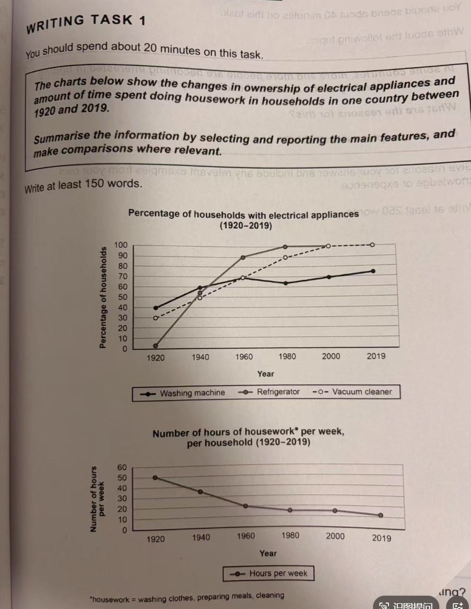

好的，这个是小作文，题干如图，这是我的文章：The two line graphs illustrate the changes in people who own the electrical appliances and how long the time they spent on doing housework in households in one country from 1920 to 2019.

Overall, it clear that ownership of electrical appliances increased significantly over the period. Meanwhile, the time of people who spent in chores experienced a decline between 1920 and 2019. 

In 1920, the percentage of households with electrical appliances was the smallest point. The proportion of washing machine was 40%, and the refrigerator was about only 2%, besides the percentage of the vacuum cleaner had 30%. And the proportion of refrigerator increased dramatic from 1920 to 1980, being noted at almost 100% in 1980. Moreover, the proportion of vacuum cleaner rose from an initial 30% in 1920 to 100% in 2000 and kept steadily in the next 19 years. The rate of washing machine grew gradually from 40% to 60% in the initial 40 years, and marked the point at the vacuum cleaner in 1960. But decreased slightly in next 20 years, with 63% in 1980, and then went up consistently between 1980 and 2019 at about 75%.

By contrast the number of hours of housework per week showed an opposite trend. It met the largest proportion in 1920, which about 50%. And dropped gradually from 1920 to 2019, finally decreased to 10% in 2019.

这是一份针对你这篇小作文的客观、严谨的评阅报告。

根据雅思官方评分标准，这篇作文的预估得分为 **5.5 分**。虽然你的文章结构依然保持得很好，但在图表数据读取（TA）**和**顽固语法错误（GRA）上出现了严重的失误，直接阻碍了分数的提升。

## 📊 预估得分与分项拆解 (Band Scores)

| **评分维度**         | **得分** | **核心评价与扣分点**                                         |
| -------------------- | -------- | ------------------------------------------------------------ |
| **TA (任务回应度)**  | **5.5**  | **出现致命失误。** 第二张图表的纵轴单位是 **Hours（小时）**，但你在最后一段写成了比例（`50%`, `10%`）。数据单位报错在小作文中是严重的客观事实错误，会导致 TA 直接跌至 5.5 或更低。 |
| **CC (连贯与衔接)**  | **6.0**  | 段落逻辑清晰（总体趋势 ➔ 电器图表 ➔ 时间图表）。但高频使用 `And`, `But` 作为句首词，且存在“残缺句”（Fragment），破坏了句间衔接。 |
| **LR (词汇丰富度)**  | **5.5**  | 词汇多样性略有提升，尝试了 `initial`, `opposite trend` 等表达。但主体段中对“电器比例”的表达过于生硬（如 `the proportion of washing machine` 应为 `...households with washing machines`）。 |
| **GRA (语法准确性)** | **5.0**  | **未修正上一篇指出的核心错误**：修饰动词依然错用了形容词（`increased dramatic`）。此外，高频出现“句子缺主语/谓语动词”的严重结构错误。 |

## ❌ 核心问题与精准纠错（通往 6.5 的必经之路）

你需要特别重视以下三个硬伤：

### 1. 致命的数据单位误读（TA 扣分点）

- **原文**：*It met the largest proportion in 1920, which about **50%**... finally decreased to **10%** in 2019.*
- **纠正**：看清第二张图表的 Y 轴是 `Number of hours per week`。
  - 修改为：*It started at its highest point of **50 hours** in 1920... finally decreased to **10 hours** in 2019.*

### 2. 顽固词性错误：修饰动词必须用副词

在上一篇的报告中我重点指出了这个错误，但本篇再次出现。

- **原文**：*And the proportion of refrigerator increased **dramatic**...*
- **纠正**：*The proportion of refrigerators increased **dramatically**...*（切记：加 **-ly**！）

### 3. 残缺句 (Sentence Fragments) 与谓语缺失

英语句子必须有完整的主谓结构，不能只有一个从句或者用连词起头却缺主语。

- **错误 1**：*Overall, it clear that...* (缺谓语动词)
  - **修正**：*Overall, it **is** clear that...*
- **错误 2**：*...which about 50%.* (缺谓语动词)
  - **修正**：*...which **was** about 50 hours.*
- **错误 3**：*But decreased slightly in next 20 years...* (无主语，不能独立成句)
  - **修正**：***It then** decreased slightly in the next 20 years...*

## 📝 6.5 分实战冲刺版范文 (Target: 6.5)

> **特点**：严格修正了你的数据错误和语法硬伤，句式保持简单复合句，符合你的真实考场操作水平。

The two line graphs illustrate the changes in the percentage of households owning electrical appliances and the amount of time spent on housework per week in one country from 1920 to 2019.

Overall, it is clear that appliance ownership increased significantly over the period. Meanwhile, the time spent on chores experienced a continuous decline.

In 1920, the percentage of households with washing machines was 40%, while vacuum cleaners and refrigerators stood at 30% and roughly 2% respectively. Over the following decades, the figure for refrigerators increased **dramatically**, reaching 100% in 1980. Similarly, the proportion of vacuum cleaners rose to 100% in 2000 and remained steady until 2019. The rate for washing machines grew to around 70% in 1960, matching vacuum cleaners. **It then** dropped slightly in 1980 before rising again to about 75% in 2019.

By contrast, the number of **hours** spent on housework showed an opposite trend. It started at its highest point of **50 hours** per week in 1920. This number then dropped gradually over the next 99 years, finally decreasing to just **10 hours** in 2019.

## 🚀 7.5+ 进阶高分版范文 (Target: 7.5+)

> **特点**：使用了高级同义替换（如 *surge, plummet, inverse relationship*），长短句结合，学术感极强。

The provided line graphs delineate the shifts in electrical appliance ownership alongside the corresponding weekly hours dedicated to domestic chores in a specific nation spanning from 1920 to 2019.

Overall, there was a pronounced inverse relationship between the two metrics: as the adoption of household appliances surged, the labor burden of housework steadily plummeted.

Looking at appliance ownership, the most striking trajectory was that of refrigerators. Starting from a negligible 2% in 1920, this figure skyrocketed to universal ownership (100%) by 1980. Vacuum cleaners followed a similar, albeit slightly more gradual upward trend, climbing from 30% to 100% by the year 2000. Washing machines, conversely, experienced a more fluctuating pattern. Beginning at 40% in 1920, the proportion peaked at roughly 70% in 1960, experienced a slight dip two decades later, and eventually recovered to approximately 75% by 2019.

In tandem with these technological advancements, the time devoted to household chores saw a dramatic reduction. In 1920, an average household spent a staggering 50 hours per week on such tasks. This figure witnessed a consistent and uninterrupted decline over the century, culminating in a mere 10 hours per week in 2019.

在这次评阅中，你是否清楚了为什么数据单位写错（% vs hours）会导致严重扣分？另外，对于“修饰动词必须加 -ly”以及“句子不能缺主语”这两个语法点，你现在完全掌握了吗？收到你的确认信号后，我们再继续。