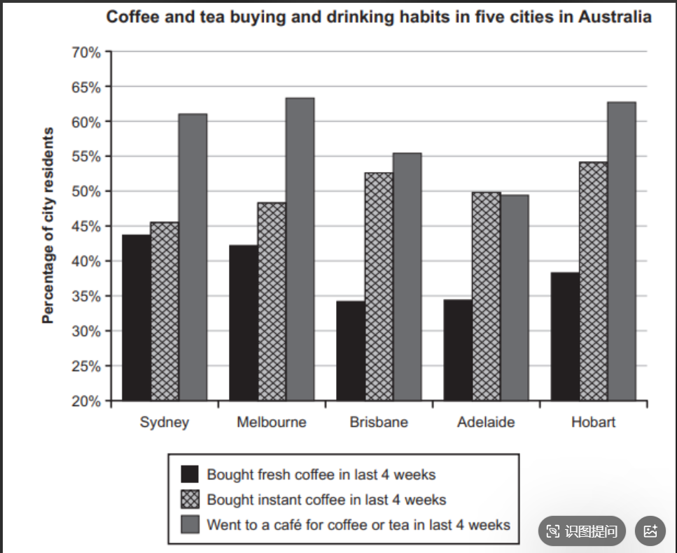

题干：In some countries, owning a home rather than renting one is very important for people. Why might this be the case? Do you think this is a positive or negative situation?大作文：Nowadays, buying a house instead of renting a house is a vital choice for people in some countries. There are many reason for this phenomenon. In my point of view, it is a thing which is negative.

It is undeniable that buying a home for people themselves have some advantages. Owning a house can offer people a sense of home. When their friends or neighbors visit their shelter, they can chat with the visitor confidently about their house, and the will avoid to receive the rushed urge fromlandlord.

But buying a home have significant negative that can not be hidden. Firstly, a people who buy a house often need lots of money. In this era, some unfavorable economic conditions make it difficult for people to earn more money.To afford the payment, they have to take out a loan or borrow for money, this will without doubt give very heavy economic pressure for people, especially for young man who just graduate from university. If in this time they unfortunatly meet some unexpected conditions such as a sick or a crash, they will suffer serious consequences due to their inability to afford it. Secondly, buying a home means that they will be living here for a very long time. In this case, if one day they decide to find a new career in a new city or just want to change the living environment, at this moment, they must consider about their house, this is quite a troublesome matter. However, renting a home is a best way for people to have their shelter. They do not need to worry about the payment, they will have more cash stream in their hand to face the difficult things in other fields of their life. Even if they intend to move to a new city, they just need to do is to return the lease to the landlord.

In my opinion, owning a home have some advantages like offer people a sense of home. But they may end up in debt or face significant financial pressure due to the purchase of a house, and the flexibility of their lives will also be greatly reduced, these problems is serious condition for a people. In conclusion, owning a home is a negative situation.

## 📊 预估得分与分项拆解 (Band Scores)

> **综合预估得分：5.5 分（目标 6.5 分，需重点解决段落详略失衡与顽固语法习惯）**

| **评分维度**         | **得分** | **核心评价与扣分点**                                         |
| -------------------- | -------- | ------------------------------------------------------------ |
| **TR (任务回应度)**  | **5.5**  | 回答了两个问题（为什么重要 + 积极还是消极）。**核心失分点在于结构严重失衡**：Body 1（回答第一个问题：原因）只有短短 3 句话，且“和访客自信聊天”直接照搬了上一篇“研究房子历史”的万金油论点，缺乏针对性；Body 2（回答第二个问题：消极影响）却极长，且后半段偏离成了“吹捧租房的好处”，而非集中讨论“执着买房的消极面”。 |
| **CC (连贯与衔接)**  | **6.0**  | 宏观分段清晰，Body 2 内部的论点展开（经济压力 + 失去跨城市流动的灵活性）非常符合逻辑。但**上一篇刚强调过的“句首禁用 But”以及“逗号拼接（Comma Splice）”依然高频出现**。 |
| **LR (词汇丰富度)**  | **6.0**  | **有明显进步！** 尝试使用了 *take out a loan, unfavorable economic conditions, inability to afford, flexibility* 等非常切题的表达。但存在局部的词义误用（如多次用 *shelter* 指代普通住宅，*shelter* 通常指“避难所/收容所”；用 *cash stream* 代替 *cash flow*）。 |
| **GRA (语法准确性)** | **5.0**  | **严重拖后腿项。** 动名词作主语时的主谓不一致（*buying a home... have*）、`people` 的单复数误用（*a people*）、词性混淆（*significant negative*, *a sick*）错误依然密集。 |

## 💡 文章亮点

1. **Body 2 的论证逻辑非常扎实**：在论证“为什么这是消极现象”时，你从“年轻人背负房贷后抗风险能力变差（遇到生病或意外）”以及“绑定在一个城市丧失职业流动性”两个维度展开，说理非常透彻、接地气，完全具备 6.5 分的论证深度。
2. **亮眼词汇尝试**：准确使用了 *take out a loan*（贷款）、*economic pressure*（经济压力）、*flexibility*（灵活性）。

## ❌ 核心问题与精准纠错（通往 6.5 的必经之路）

### 1. 顽固错误复发（必须立刻纠正！）

- **句首再次出现 `But`**：第三段开头 *`But buying a home...`* 以及结尾段 *`But they may end up...`*。**切记：句号后面绝不用 But，全部替换为 `However,`！**
- **动名词作主语，谓语必须用单数**：
  - ❌ *`buying a home` for people themselves `have` some advantages.*
  - ❌ *`buying a home` `have` significant negative...*
  - ❌ *`owning a home` `have` some advantages...*
  - ✅ **修正公式**：`Buying / Owning a home`（一件事）+ **`has`**！

### 2. 高频基础语法硬伤（GRA 提分关键）

- **`people` 本身就是复数，绝不能加 `a`！**
  - ❌ *`a people` who `buy` a house often `need`...*
  - ✅ 修改：*`People` who `buy` a house often `need`...* 或 *`A person` who `buys` a house often `needs`...*
- **词性误用（把形容词当名词用）**：
  - ❌ *have significant `negative`* ➔ ✅ *have significant `negative effects` / `drawbacks`*
  - ❌ *meet some unexpected conditions such as `a sick`* ➔ ✅ *such as `an illness` / `a serious disease`*（*sick* 是形容词，不能加 a）。
- **固定搭配与冗余介词**：
  - ❌ *borrow `for` money* ➔ ✅ *borrow money*
  - ❌ *consider `about` their house* ➔ ✅ *consider their house*（*consider* 直接加宾语，绝不加 about）。
  - ❌ *avoid `to receive`* ➔ ✅ *avoid `receiving`*（*avoid* 后面永远加 `doing`）。

### 3. 逗号拼接句（Comma Splice）

- ❌ *...take out a loan or borrow money, this will without doubt give...*
- ✅ 修改：*...take out a loan, **which** will undoubtedly bring...*（用 `which` 引导非限制性定语从句，瞬间从 5 分错误句变成 6.5 分高分复合句！）

## 📝 双版本重写示范 (Rewrite Samples)

### 🎯 版本一：6.5 分实战冲刺版

> **调整策略**：保留你所有的核心观点，扩充了第一段的原因（加入“财务安全感/免受房东驱赶”），修正了所有语法硬伤，并将逗号拼接句升级为定语从句。

Nowadays, buying a house instead of renting one is a vital goal for people in some countries. There are several **reasons** for this phenomenon, and from my point of view, this trend is largely a **negative situation**.

It is understandable why people prefer to own a home. Firstly, owning a house **offers** people a strong sense of belonging and security. Unlike tenants, homeowners do not need to worry about **receiving** sudden requests to move out from a landlord. Secondly, in many cultures, a house is seen as a symbol of stability and financial success, allowing owners to feel proud and confident when hosting friends or neighbors.

**However**, this obsession with buying a home **has** significant **drawbacks** that cannot be ignored. Firstly, **people** who buy a house need a large amount of money. Under current unfavorable economic conditions, many buyers have to take out a heavy loan, **which** undoubtedly creates immense financial pressure, especially for young graduates. If they **unfortunately** encounter unexpected emergencies, such as **a serious illness** or an accident, they may suffer severe consequences due to their inability to repay the debt. Secondly, buying a home ties people to one location for a long time. If they decide to pursue a new career in another city, selling or managing the house becomes a troublesome matter. By contrast, renting allows people to keep more **cash flow** to deal with other life difficulties and gives them the freedom to move easily.

In conclusion, although owning a home **has** some advantages like providing a sense of security, buyers often end up in heavy debt and lose their life flexibility. Since **these problems are** very serious, I believe the pressure to own a home is a negative situation.

### 🚀 版本二：7.5+ 进阶高分版

> **调整策略**：使用更地道的学术表达（如 *homeownership, psychological security, mortgage, upward mobility*），逻辑衔接更紧凑。

In many parts of the world, placing a high priority on homeownership over renting is a deeply ingrained cultural norm. While this mindset stems from a desire for stability and social status, I firmly believe that an excessive focus on buying property leads to predominantly negative consequences.

There are two primary reasons why people are so eager to purchase their own homes. Foremost among these is the pursuit of psychological security and autonomy. Unlike tenants, who are often at the mercy of landlords and face the risk of sudden eviction or rent hikes, homeowners enjoy permanent shelter and complete control over their living space. Furthermore, in many societies, owning real estate is traditionally viewed as a milestone of adulthood and a reliable long-term investment, offering individuals a sense of pride and social recognition.

Nevertheless, this relentless pursuit of homeownership brings about severe drawbacks, particularly in today's challenging economic climate. Firstly, sky-rocketing property prices force buyers—especially young university graduates—to take on massive mortgages. This heavy debt burden leaves them financially vulnerable; if they encounter unforeseen crises such as a medical emergency or job loss, their inability to maintain repayments can lead to bankruptcy. Secondly, being tied to a mortgage significantly restricts geographical and career mobility. When lucrative job opportunities arise in another city, homeowners cannot relocate as effortlessly as renters, who can simply terminate their lease and maintain healthy cash flow for other life investments.

In conclusion, while owning a property undeniably provides a sense of permanence, the resulting financial strain and loss of flexibility are far too costly. Therefore, I contend that the societal pressure to buy rather than rent is a detrimental trend.

看完了这篇大作文的评阅，你对“动名词作主语谓语用单数（Buying a home has...）”**以及**“用 which 替代逗号拼接”这两个修改点清楚了吗？有没有任何疑问？

收到你的反馈后，请把今天的**小作文**发给我，我们继续！

The chart below shows the results of a survey about people's coffee and tea buying and drinking habits in five Australian cities. Summarise the information by selecting and reporting the main features, and make comparisons where relevant小作文：This bar chart illustrates the proportion of people's habit in buying and drinking coffee and tea in Australian five cities in last 4 weeks.

In Sydney, the proportion of people who bought fresh coffee in last 4 week is about 44%, which is the largest in five cities. The second city is Melbourne(43%), and the rate of Hobart is 37%. The difference between Brisbane and Adelaide was barely noticeable(34%). Meanwhile, the percentage of prople who bought instant coffee in last 4 weeks at about 46% in Sydeny, and the rate in Melbourne is a little more than  Sydeny(48%). There was a tiny difference between Brisbane and Hobart, which is about 53% and 54%. There are 50% of people in Adelaide  bought instant coffee in last 4 weeks.

However, the rate of people went to a cafe for coffee or tea in last 4 weeks is strikingly higher than other typs of habit in 5 cities. Melbourne is the largest city in this type of habit, at 64%. Following  Melbourne, Hobart is the second city, which 63% of people choosing this way to drinking coffee or tea. The percentage of Sydney is about 61%. There is a noticeably higher proportion of Brisbane than Adelaide, being noted at 56%, and  Adelaide has 49%.

Overall, the habit of going to a cafe for coffee or tea is the most popular way for people enjoy their coffee or 
tea, and bought instant coffee is the second method for people. people who bought fresh coffee is the lowest choice between these 3 habits.

这篇静态柱状图（Bar Chart）的写作中，你的**分段策略（Grouping）非常聪明**——你没有按城市一个个报流水账，而是按“三种消费习惯”分类对比，这是冲刺 6.5 分非常推荐的高分结构。

但是，这篇文章在客观事实读取（TA）**上漏掉了一个图表最大的“陷阱/特征”，且**之前总结过的几项核心语法错误（GRA）再次出现，因此目前综合得分依然卡在 **5.5 分**。

以下是客观、严谨的评阅报告：

## 📊 预估得分与分项拆解 (Band Scores)

> **综合预估得分：5.5 分（目标 6.5 分，需重点解决“关键特征遗漏”与“句式杂糅/时态混乱”）**

| **评分维度**          | **得分** | **核心评价与扣分点**                                         |
| --------------------- | -------- | ------------------------------------------------------------ |
| **TA (任务完成情况)** | **5.5**  | **存在关键事实错误（Key Feature Misrepresentation）。** 你在第三段和结尾段都绝对化地写出“去咖啡馆在 5 个城市中都是最高的”。但仔细看图中的 **Adelaide（阿德莱德）**：买速溶咖啡（阴影柱，约 50%）**高于**去咖啡馆（灰色柱，约 49%）！在静态图中，这种“唯一打破规律的特例（Exception）”是考官最看重的采分点，漏掉或说反会直接把 TA 压制在 5.5 分。 |
| **CC (连贯与衔接)**   | **6.0**  | 按消费类别分段（新鲜咖啡+速溶咖啡一段，去咖啡馆一段），逻辑条理清晰。能够使用 *Meanwhile, However, Overall* 进行过渡。 |
| **LR (词汇丰富度)**   | **5.5**  | 尝试了 *barely noticeable, strikingly higher* 等非常好的程度副词短语！但低级拼写错误再次反弹（*prople, Sydeny, typs*），且多次出现概念偷换（如 *Melbourne is the largest city* 变成了比较城市面积大小）。 |
| **GRA (语法准确性)**  | **5.0**  | **核心失分项。** 出现多处由于刚学过的语法规则未消化导致的“无谓语残缺句”、“双谓语杂糅句（There are... bought...）”以及**过去时与现在时全篇随机混用**。 |

## ❌ 核心问题与精准纠错（通往 6.5 的必经之路）

### 1. 读图关键陷阱：必须揪出“特例 (Exception)”

- **你的原文**：*...went to a cafe... is strikingly higher than other typs of habit **in 5 cities**.*
- **事实核查**：观察 Adelaide 的柱子，买速溶咖啡（Instant coffee）达到了 50%，而去咖啡馆（Went to a café）略低于 50%（约 49%）。   
- **6.5 分高分写法**：在 Overall 中指出这个特例——*Going to a café was the most popular habit in all cities **except Adelaide**.*（只要加上 `except Adelaide`，TA 项立刻能上 6.5 甚至 7.0！）

### 2. 顽固语法硬伤复发与新句型错误

- **错误 A：刚刚强调过的“动词原形作主语”再次出现**
  - ❌ *...and **bought** instant coffee is the second method...*
  - ✅ **修正**：*...and **buying** instant coffee was the second most popular method...*
- **错误 B：`There be` 句型双谓语杂糅（中式英语重灾区）**
  - ❌ *`There are` 50% of people in Adelaide `bought` instant coffee...*（一句话里出现了 `are` 和 `bought` 两个动词打架）。
  - ✅ **修正方案 1（去掉 There are）**：*50% of people in Adelaide **bought** instant coffee.*
  - ✅ **修正方案 2（加 who 变成定语从句）**：*There were 50% of people in Adelaide **who bought** instant coffee.*
- **错误 C：句子缺少谓语动词 / 从句残缺**
  - ❌ *Meanwhile, the percentage of prople who bought instant coffee in last 4 weeks `at` about 46%...*（主语是 `the percentage`，后面只有介词 `at`，没有主句动词 `was`！）
  - ✅ **修正**：*Meanwhile, the percentage of people who bought instant coffee **was** about 46%...*
  - ❌ *...Hobart is the second city, `which` 63% of people `choosing` this way `to drinking`...*
  - ✅ **修正**：*...Hobart was second, **with** 63% of people **choosing** this way **to drink**...*（`to` 后面接动词原形 `drink`）。

### 3. 时态混乱与拼写/表达纠错

图例明确写了 `Bought... / Went... in last 4 weeks`（过去四周内发生的调查动作），因此全文主体段汇报数据时，统一用一般过去时（was/were/bought）最稳妥，不要一句用 `is` 下一句用 `was`。   

| **原句 / 错词**                                       | **错误类型** | **诊断与修改建议**                                           |
| ----------------------------------------------------- | ------------ | ------------------------------------------------------------ |
| *prople / Sydeny / typs*                              | 低级拼写错误 | **people / Sydney / types**（考场最后 3 分钟必须扫视检查！） |
| *in Australian five cities*                           | 语序错误     | 改为 *in **five Australian cities***（数量词永远在形容词前面）。 |
| *Melbourne is the largest city in this type...*       | 概念偷换     | “墨尔本是最大的城市”变成了比面积。应改为 *Melbourne had **the highest percentage** in this category...* |
| *people who bought fresh coffee is the lowest choice* | 主谓逻辑不通 | “人”不能是“最低的选择”。应改为 ***Buying fresh coffee** was the **least popular** choice.* |

## 📝 双版本重写示范 (Rewrite Samples)

### 🎯 版本一：6.5 分实战冲刺版

> **调整策略**：保留你按“咖啡类型”分段的优秀结构，将 Overview 提至第二段（更符合考官阅读习惯），修复了时态、双谓语和 Adelaide 的特例问题。

The bar chart illustrates the percentage of residents in **five Australian cities** who had three different coffee and tea buying and drinking habits over the last four weeks.   

Overall, going to a café for coffee or tea **was** the most popular choice in almost all surveyed cities, **with the exception of Adelaide**. By contrast, **buying** fresh coffee was the least common habit across all five locations.   

Regarding coffee purchases, the proportion of people who bought fresh coffee in Sydney **was** the highest at about 44%, closely followed by Melbourne (42%) and Hobart (38%). The figures for Brisbane and Adelaide **were** the lowest, with a barely noticeable difference at around 34% each. Meanwhile, **buying** instant coffee was more popular. Hobart and Brisbane recorded the highest percentages at roughly 54% and 53% respectively. In Adelaide, exactly 50% of residents **bought** instant coffee, while the rates in Melbourne (48%) and Sydney (45%) **were** slightly lower.   

On the other hand, the percentage of people who went to a café **was** strikingly higher than the other two habits in four of the cities. Melbourne had **the highest figure** at 64%, followed closely by Hobart (63%) and Sydney (61%). Lastly, Brisbane stood at about 55%, which was noticeably higher than Adelaide (49%), making Adelaide the only city where buying instant coffee surpassed visiting a café.   

### 🚀 版本二：7.5+ 进阶高分版

> **调整策略**：使用更地道的图表比较句型（如 *outnumbered, marginal disparity, anomaly*），信息密度更高，衔接极其紧密。

The bar chart compares the proportions of city dwellers across five Australian metropolises regarding their coffee and tea purchasing and consumption habits during a four-week period.   

Overall, visiting a café was overwhelmingly the most prevalent habit in four out of the five cities, whereas purchasing fresh coffee was consistently the least favored option. Notably, Adelaide stood out as the sole anomaly where instant coffee buyers outnumbered café-goers.   

Looking first at café attendance, Melbourne, Hobart, and Sydney topped the list, with well over 60% of residents in each city frequenting a café (approximately 64%, 63%, and 61%, respectively). Brisbane followed at roughly 55%, while Adelaide recorded the lowest turnout at just under 50%.   

When it comes to purchasing coffee for home consumption, instant coffee was universally preferred over fresh coffee. Hobart led the instant coffee category at 54%, marginally ahead of Brisbane (53%) and Adelaide (50%), whereas Melbourne (48%) and Sydney (45%) registered slightly lower figures. Conversely, fresh coffee was most sought-after in Sydney (44%) and Melbourne (42%), followed by Hobart at 38%. Brisbane and Adelaide shared the lowest proportion of fresh coffee buyers, both standing at an identical 34%.   

在这篇小作文的评阅中，你看到 **Adelaide（阿德莱德）** 那个速溶咖啡高于咖啡馆的细节了吗？同时，对于 **`There are... bought...`（双谓语错误）** 和 **`Melbourne is the largest city`（概念偷换）** 这两个问题，你清楚该如何规避了吗？   

收到你的反馈后，我们再继续下一步！