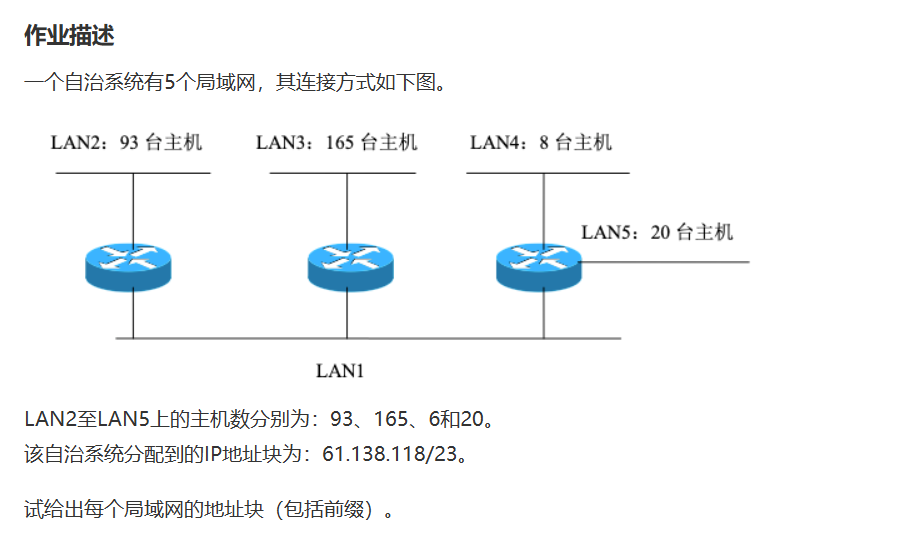

这类题考的是 **CIDR 变长子网掩码（VLSM）划分**。做这类题只要掌握**四个核心规则**，按固定流程走就不会出错。

### 一、 变长子网划分（VLSM）核心知识复习

#### 1. 算准每个子网的“真实地址需求量”（最易漏掉两点）

一个局域网需要分配的 IP 地址数量，**绝不只是题目给出的“主机数”**，必须加上两项开销：

$$\text{所需总地址数} = \text{主机数} + \text{该局域网连接的路由器接口数} + 2$$

- **加路由器接口数**：路由器连接在哪个局域网，就需要占用该局域网的 $1$ 个合法 IP 作为网关地址。例如本题中，主干网络 **LAN1** 虽然没有普通主机，但它连接了 **$3$ 个路由器接口**，因此需要 $3$ 个可用 IP。   
- **加 $2$**：扣除主机号全 `0` 的**网络地址**和主机号全 `1` 的**广播地址**（常规考试均按传统规则扣除这 $2$ 个特殊地址）。

#### 2. 确定主机号位数 $n$ 与子网前缀 $/P$

根据“所需总地址数”，向上取最接近的 $2$ 的整数次幂 $2^n$（即满足 $2^n \ge \text{所需总地址数}$ 的最小整数 $n$）：

- **子网地址块大小** $= 2^n$（包含的 IP 总个数）
- **子网网络前缀长度** $P = 32 - n$（记作 `/P`）

#### 3. 分配顺序铁律：“从大到小”

**必须按所需地址块从大到小的顺序依次分配。**

- **原理（边界对齐要求）**：一个前缀为 `/(32-n)` 的 CIDR 地址块，其起始地址的二进制后 $n$ 位必须全为 `0`（反映在十进制的最后一个字节上，就是**起始数字必须是块大小 $2^n$ 的整数倍**）。
- 按“从大到小”分配，每次切分都自然落在 $2^n$ 的整数倍边界上，不会产生地址重叠或浪费。

### 二、 本题完整计算步骤

已知总地址块为 `61.138.118.0/23`，前 $23\text{ bit}$ 为网络前缀，后 $9\text{ bit}$ 为主机号，包含从 `61.138.118.0` 到 `61.138.119.255` 共 $2^9 = 512$ 个地址。   

#### 第 1 步：统计所有局域网需求，并按地址块“从大到小”排序

| **排序** | **局域网** | **主机数**    | **路由器接口数** | **特殊保留** | **所需总地址数** | **满足 2n≥总数2^n \ge \text{总数}2n≥总数 的最小块** | **子网前缀** |
| -------- | ---------- | ------------- | ---------------- | ------------ | ---------------- | --------------------------------------------------- | ------------ |
| **1**    | **LAN3**   | $165$         | $1$              | $2$          | $168$            | $2^8 = 256$                                         | **`/24`**    |
| **2**    | **LAN2**   | $93$          | $1$              | $2$          | $96$             | $2^7 = 128$                                         | **`/25`**    |
| **3**    | **LAN5**   | $20$          | $1$              | $2$          | $23$             | $2^5 = 32$                                          | **`/27`**    |
| **4**    | **LAN4**   | $6$（或 $8$） | $1$              | $2$          | $9$（或 $11$）   | $2^4 = 16$                                          | **`/28`**    |
| **5**    | **LAN1**   | $0$           | $3$              | $2$          | $5$              | $2^3 = 8$                                           | **`/29`**    |

*(注：所有局域网合计消耗 $256 + 128 + 32 + 16 + 8 = 440 \le 512$ 个地址，总地址块完全够用。)*

#### 第 2 步：从 `61.138.118.0` 开始依次连续切分

1. **分配 LAN3（`/24`，块大小 $256$）**：
   - **地址块**：**`61.138.118.0/24`**
   - **范围**：`61.138.118.0` $\sim$ `61.138.118.255`（刚好用完 `.118` 这一整段，下一个可用地址从 `61.138.119.0` 开始）。
2. **分配 LAN2（`/25`，块大小 $128$）**：
   - 检查对齐：$0$ 是 $128$ 的整数倍，直接分配。
   - **地址块**：**`61.138.119.0/25`**
   - **范围**：`61.138.119.0` $\sim$ `61.138.119.127`（下一个可用地址为 `61.138.119.128`）。
3. **分配 LAN5（`/27`，块大小 $32$）**：
   - 检查对齐：$128 \div 32 = 4$（整除，满足边界对齐）。
   - **地址块**：**`61.138.119.128/27`**
   - **范围**：`61.138.119.128` $\sim$ `61.138.119.159`（$128 + 32 - 1 = 159$，下一个可用地址为 `61.138.119.160`）。
4. **分配 LAN4（`/28`，块大小 $16$）**：
   - 检查对齐：$160 \div 16 = 10$（整除，满足边界对齐）。
   - **地址块**：**`61.138.119.160/28`**
   - **范围**：`61.138.119.160` $\sim$ `61.138.119.175`（$160 + 16 - 1 = 175$，下一个可用地址为 `61.138.119.176`）。
5. **分配 LAN1（`/29`，块大小 $8$）**：
   - 检查对齐：$176 \div 8 = 22$（整除，满足边界对齐）。
   - **地址块**：**`61.138.119.176/29`**
   - **范围**：`61.138.119.176` $\sim$ `61.138.119.183`（$176 + 8 - 1 = 183$，剩余 `61.138.119.184` $\sim$ `61.138.119.255` 共 $72$ 个地址留作备用）。

> **学术严谨性补充**：CIDR 子网划分的**答案并不唯一**（例如第一步如果把高位的 `61.138.119.0/24` 分给 LAN3，把低位的 `61.138.118.0/24` 留给后面继续切分，也是完全合法的），但无论怎么选高低位，各局域网对应的**前缀长度（`/24, /25, /27, /28, /29`）和块大小是唯一确定的**。按从低地址向高地址连续分配是最标准、最不易算错的写法。

