# 主观题

> [!IMPORTANT]
>
> 期末考试这些大题的类型必考，请务必按照题目自己先做一遍，再看答案。我们按照层次从低到高来。
>
> 配有我手写答案与AI确定(有的）的标准答案。

## 性能指标计算题


1. **计算传播时延（$t_{\text{传播}}$）** 已知月球到地球的距离 $d = 3.9 \times 10^5\text{ km}$，信号传播速率 $v = 3.0 \times 10^5\text{ km/s}$：   

   $$t_{\text{传播}} = \frac{d}{v} = \frac{3.9 \times 10^5\text{ km}}{3.0 \times 10^5\text{ km/s}} = 1.3\text{ s}$$

2. **计算发送时延（$t_{\text{发送}}$）** 已知照片传回地球所需的总时间 $t_{\text{总}} = 501.3\text{ s}$，减去传播时延即可得到纯发送数据所用的时间：   

   $$t_{\text{发送}} = t_{\text{总}} - t_{\text{传播}} = 501.3\text{ s} - 1.3\text{ s} = 500\text{ s}$$

3. **计算照片大小（$L$）** 链路带宽（发送速率）为 $R = 200\text{ kbps} = 200 \times 10^3\text{ bit/s}$，因此照片的总比特数为：   

   $$L = R \times t_{\text{发送}} = (200 \times 10^3\text{ bit/s}) \times 500\text{ s} = 1 \times 10^8\text{ bit}$$


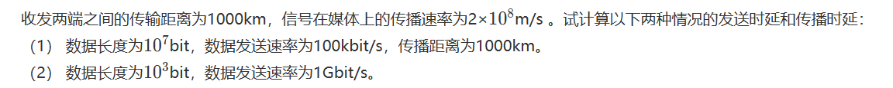

1.发送时延：1e7bit/100kbps =100s
传播时延：1000km/ (2*1e8m/s) = 0.005s

2.发送时延：1e3bit/1Gbps = 1e-6s
传播时延： 1000km/ (2*1e8m/s) = 0.005s


## 物理层

- 共有四个站进行码分多址CDMA通信。四个站的码片序列分别为：
  A：(-1 -1 -1 +1 +1 -1 +1 +1)
  B：(-1 -1 +1 -1 +1 +1 +1 -1)
  C：(-1 +1 -1 +1 +1 +1 -1 -1)
  D：(-1 +1 -1 -1 -1 -1 +1 -1)
  现收到这样的码片序列：(-1 +1 -3 +1 -1 -3 +1 +1)。问：
  1）哪个站发送数据了？
  2）发送数据的站发送的是0还是1？
  
- 要用3KHz带宽的电话信道传送64Kbps的数据（无差错传输），试问这个信道应具有多高的信噪比（分别用比值和分贝来表示）？

- 为什么要使用信道复用技术？常用的信道复用技术有哪些？

  

## 数据链路层

### CRC

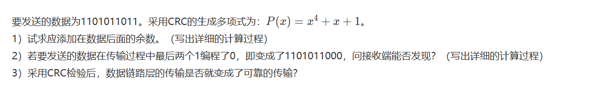

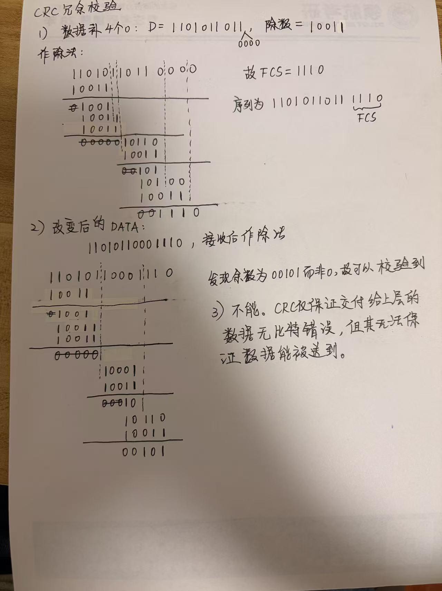

### IEEE 802.3以太网标准下MAC帧的格式及最短帧长

通过IEEE 802.3局域网传送ASCII码信息“Good morning!”，若封装成一个MAC帧，
（1）该帧的数据字段有效字节为多少？
（2）需要填充多少个字节？

A:（1）一个ASCII占用1字节，这句话一共占用13字节。那么有效字节也是13字节。

（2）数据段长度46字节，现在是13字节，故填充33字节。

### CSMA/CD

简述工作原理。

CSMA/CD（载波监听多点接入/碰撞检测）是传统总线型以太网中使用的介质访问控制协议，核心工作流程可概括为“先听后发、边听边发、冲突停发、随机重发”四个步骤：

1. **先听后发（载波监听，Carrier Sense）** 适配器在发送数据前，先持续检测信道上是否有其他站点正在发送信号。若检测到信道**忙**，则继续监听并等待；若检测到信道**空闲**（且维持一段帧间最小间隔时间，如 $9.6\ \mu\text{s}$），才开始发送数据帧。
2. **边听边发（碰撞检测，Collision Detection）** 站点在发送数据的同时，仍需持续监测总线上的信号电平变化。如果检测到总线信号电压摆动值超过一定门限（说明至少有两个站点同时在发送数据，信号发生了叠加碰撞），则判定发生了**碰撞（冲突）**。
3. **冲突停发（强化碰撞）** 一旦检测到碰撞，站点立即停止发送当前数据帧，并继续发送一段人为的**干扰信号（Jamming Signal，通常为 $32\text{ bit}$ 或 $48\text{ bit}$）**，以确保网络中所有其他站点都能明确感知到此次碰撞，避免出现部分站点未察觉碰撞的情况。
4. **随机重发（截断二进制指数退避算法）** 发送完干扰信号后，站点执行**截断二进制指数退避算法（Truncated Binary Exponential Backoff）**：从整数集合 $[0, 1, \dots, 2^k - 1]$ 中随机抽取一个数 $r$（其中 $k = \min[\text{重传次数}, 10]$），等待 $r \times \text{争用期}$（争用期 $2\tau$ 通常取 $51.2\ \mu\text{s}$）后，重新回到第一步监听信道并尝试重发。若连续重传 $16$ 次仍不成功，则丢弃该帧并向上层报告错误。

## 网络层

### IP校验

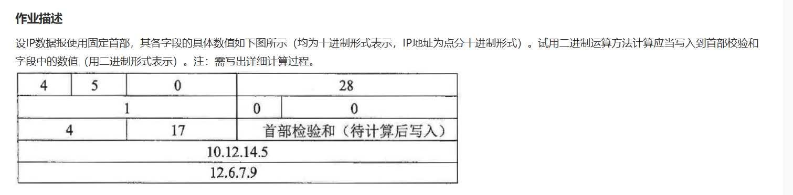

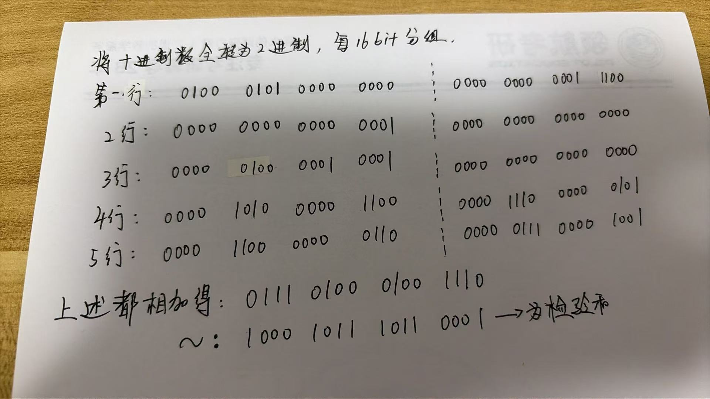

### **IP数据报首部格式（分片）**

一个UDP用户数据报的数据字段为8192字节，要使用以太网来传送。问应当划分为几个数据报片？说明每一个数据报片的数据字段长度和片偏移字段的值(IP数据报使用固定首部，MTU=1500字节)。

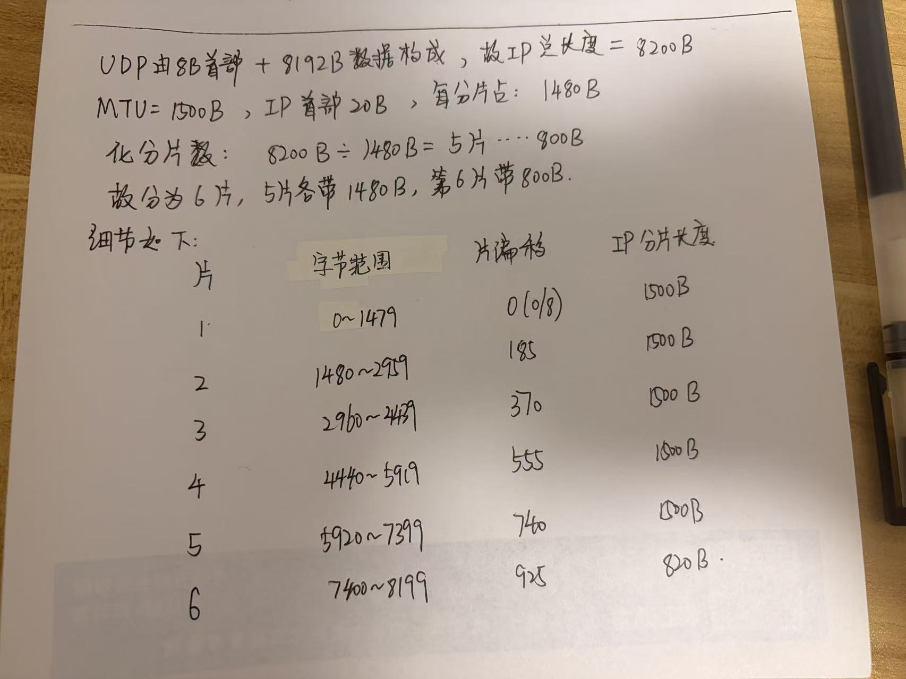

### 试说明IP地址与硬件地址的区别，为什么要使用这两种不同的地址？

**答：** IP地址是工作在**网络层**的逻辑地址，采用**层次结构**（由网络号和主机号组成），可灵活配置或动态分配，用于决定数据报在全网中的**端到端**传输路径；硬件地址（MAC地址）是工作在**数据链路层**的物理地址，固化在网卡ROM中，采用全球唯一的**平面结构**，仅用于在**同一局域网（单跳链路）内**实现相邻节点之间的帧交付。在跨网络传输过程中，IP数据报首部中的源IP和目的IP地址始终保持不变（不考虑NAT），而每经过一个路由器转发，数据帧首部中的源MAC和目的MAC地址都会重新封装并发生改变。之所以同时使用这两种地址，是因为：（1）全网底层物理网络（如以太网、Wi-Fi、广域网链路等）硬件结构各异，在网络层统一使用IP地址可以**屏蔽底层异构网络的硬件差异**，使不同网络能够互联互通；（2）MAC地址不具备位置拓扑信息，若全网直接按MAC路由，路由器将无法进行路由聚合而必须存储海量的平面表项，效率极低，而**IP地址的层次化结构**使路由器只需根据网络号即可快速选路；（3）将逻辑拓扑位置与物理硬件身份解耦，使得主机更换网卡或移动子网时无需改动全网配置，极大提升了网络管理的灵活性。

### RIP

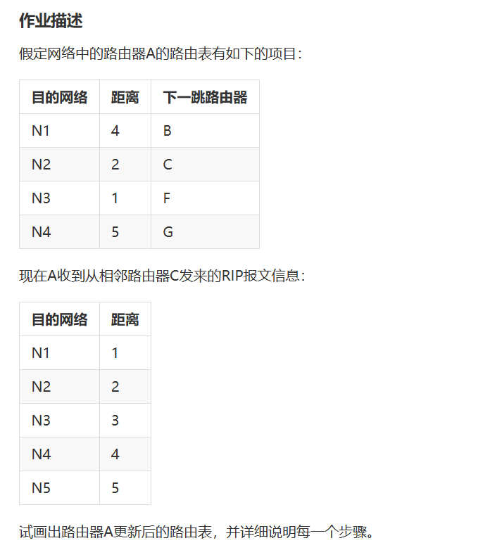

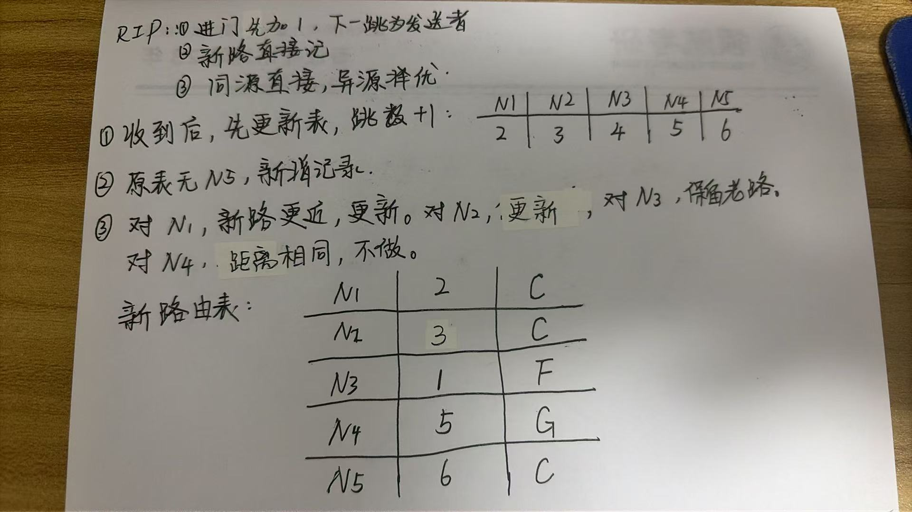

### CIDR

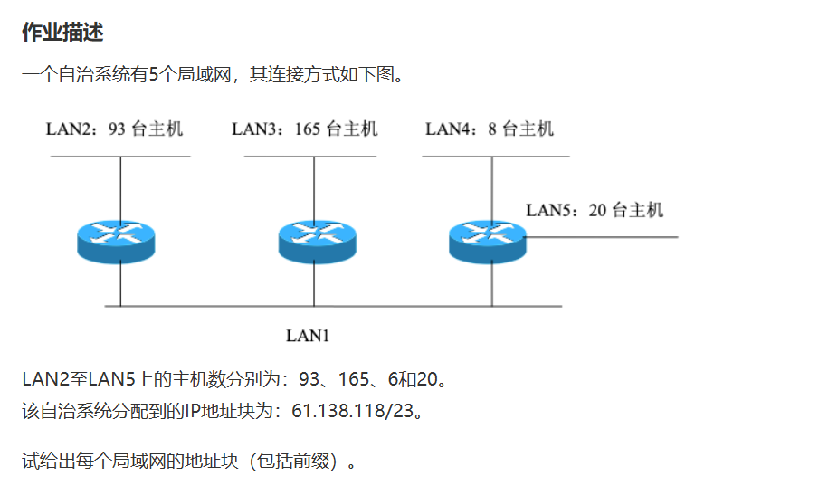

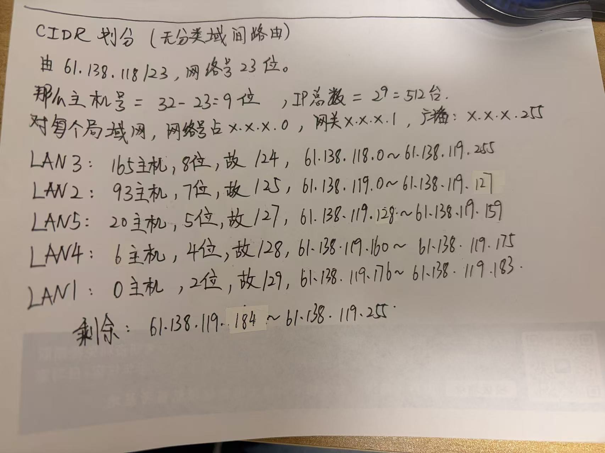

### 划分子网下的三级IP地址、定向广播

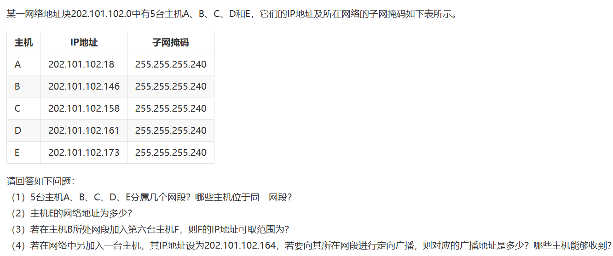

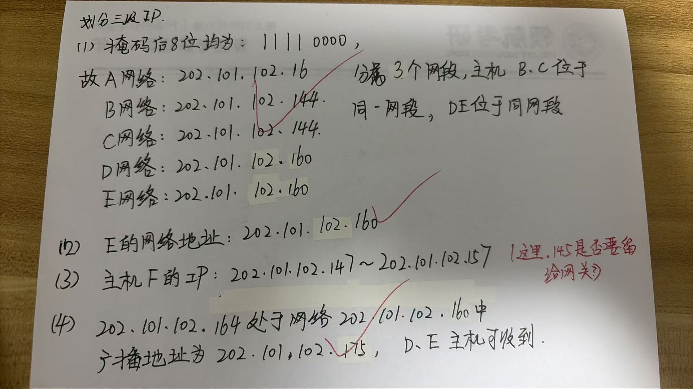

### 分组转发

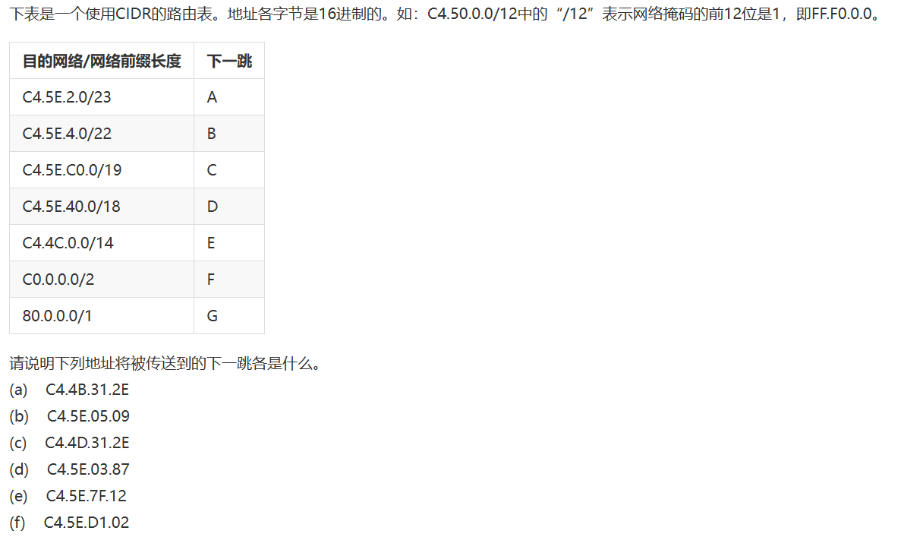

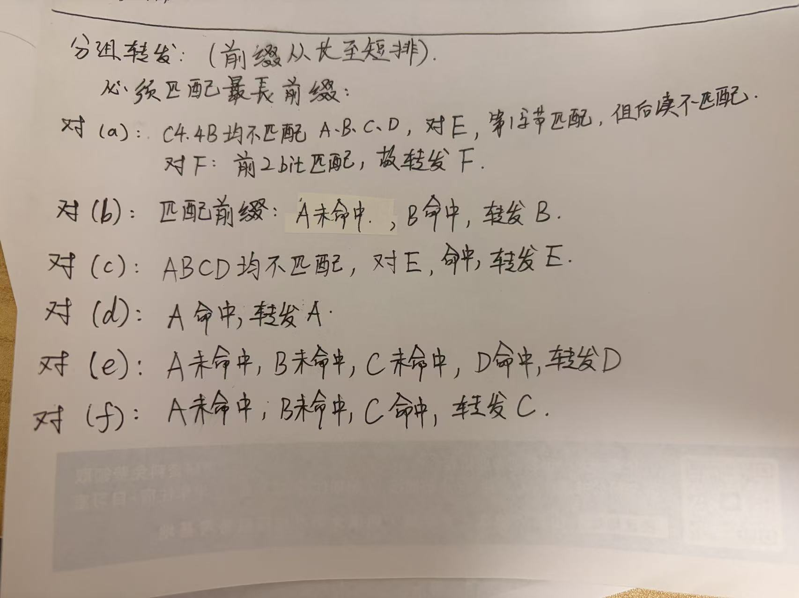

### CIDR 2.

假定一个ISP拥有形为101.101.100.0/23的地址块，要分配给四个单位使用，A单位需要115个IP地址，B单位需要238个地址，C单位需要50个IP地址，D单位需要29个IP地址。请提供满足四个单位需要的最小地址块划分（形式为a.b.c.d/x）。

**A 单位**：`101.101.101.0/25`

**B 单位**：`101.101.100.0/24`

**C 单位**：`101.101.101.128/26`

**D 单位**：`101.101.101.192/27`

### 二级IP地址

已知主机的IP地址为101.221.23.34，请确定该主机所在网络类别、网络号、主机号？

**答：**对于 IP 地址 `101.221.23.34`（默认按传统分类编址处理）：

1. **网络类别**：**A 类**
   - *依据*：首字节十进制为 `101`（二进制为 `01100101`，最高位为 `0`），落在 A 类地址 `1 ~ 126` 的范围内。
2. **网络号（Net-ID）**：**`101`**
   - *说明*：A 类地址取前 8 位（第 1 字节）作为网络号；若题目语境中将网络号等同于“网络地址”（主机号全置 `0`），则写作 **`101.0.0.0`**。
3. **主机号（Host-ID）**：**`221.23.34`**
   - *说明*：A 类地址取后 24 位（后 3 字节）作为主机号。

### ARP过程

ARP协议的功能是什么？假设主机1和主机2处于同一局域网（主机1的IP地址是172.16.22.101，主机2的IP地址是172.16.22.110），简述主机1使用ARP协议解析主机2的物理地址的工作过程。

**一、ARP协议的功能**

地址解析协议（ARP，Address Resolution Protocol）的核心功能是：**在已知目标主机IP地址（网络层逻辑地址）的前提下，解析并获取其对应的MAC地址（数据链路层物理地址）**，从而实现IP地址到MAC地址的动态映射，确保数据帧能够在局域网内准确交付给目标设备。

**二、工作过程**

1. **查询本地ARP高速缓存** 主机1（`172.16.22.101`）首先检索自身的ARP高速缓存表，查看是否已有 `172.16.22.110` 对应的MAC地址记录。若存在，则直接读取该MAC地址进行数据帧封装并发送；若不存在，则启动ARP解析流程。
2. **广播ARP请求分组** 主机1构造一个**ARP请求（ARP Request）\**分组，填入源IP（`172.16.22.101`）、源MAC地址以及目标IP（`172.16.22.110`）。随后将该分组封装在目的MAC地址为广播地址（`FF-FF-FF-FF-FF-FF`）的以太网帧中，向本局域网内\**广播**发送。
3. **接收与IP匹配** 同一局域网内的所有主机都会收到该广播帧，并将ARP分组上交至各自的ARP进程：
   - 局域网内的其他无关主机发现分组中的目标IP与自身不符，直接丢弃该分组。
   - 主机2（`172.16.22.110`）识别出目标IP与自己一致，接收该分组，同时提取出主机1的IP与MAC地址映射关系，写入自己的ARP高速缓存表中（避免后续通信再次发起ARP请求）。
4. **单播ARP响应分组** 主机2构造一个**ARP响应（ARP Response）\**分组，填入自身的IP地址（`172.16.22.110`）和MAC地址，然后以\**单播**方式（目的MAC地址直接填写主机1的MAC地址）发回给主机1。
5. **更新缓存并开始通信** 主机1收到ARP响应分组后，从中读取出主机2的MAC地址，将 `172.16.22.110` 与其MAC地址的映射写入本地ARP高速缓存表（并设置老化计时器/TTL），此后即可正常封装数据帧向主机2发送数据。

### 特殊IP地址

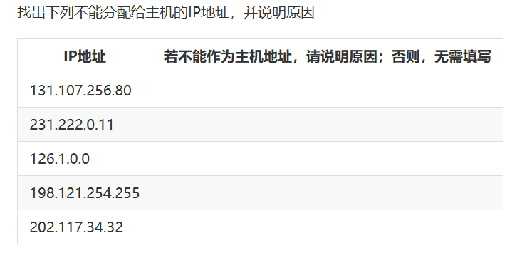

| **IP地址**          | **若不能作为主机地址，请说明原因；否则，无需填写**           |
| ------------------- | ------------------------------------------------------------ |
| **131.107.256.80**  | **非法IP地址**：点分十进制中每个字节的取值范围为 `0~255`，第3个字节 `256` 超出最大值限制。 |
| **231.222.0.11**    | **D类组播地址**：首字节 `231` 落在 `224~239` 范围内，专用于多播（组播）通信，不能分配给单个主机。 |
| **126.1.0.0**       | *(无需填写)*                                                 |
| **198.121.254.255** | **直接广播地址**：首字节 `198` 属于C类地址（默认前24位为网络号），其主机号部分 `255`（二进制全 `1`）代表向 `198.121.254.0` 网段内所有主机广播。 |
| **202.117.34.32**   | *(无需填写)*                                                 |

**补充说明（可正常分配的两项）：**

- **`126.1.0.0`**：首字节 `126` 属于A类地址（范围为 `1~126`，`127` 才是本地环回地址），默认前8位为网络号，后24位为主机号（`1.0.0` 非全 `0` 也非全 `1`），属于合法的主机地址。   
- **`202.117.34.32`**：首字节 `202` 属于C类地址（范围为 `192~223`），默认前24位为网络号，主机号为 `32`（非全 `0` 也非全 `1`），可以正常分配给主机。   

### RIP 2.

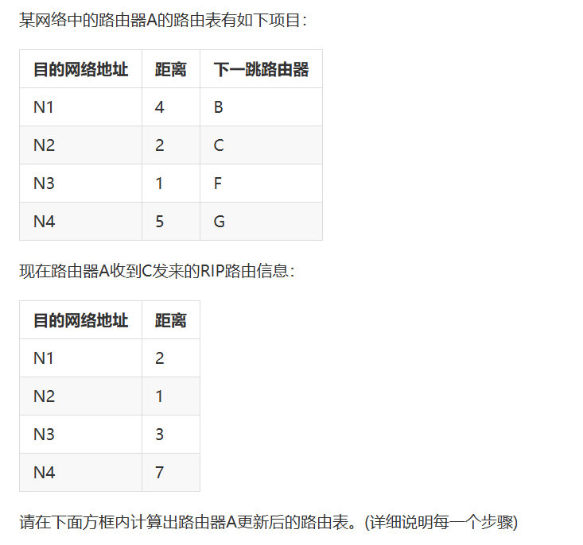

> [!WARNING]
>
> 对于 N2，原路由表中的下一跳是 C，新收到的报文也是 C 发来的（下一跳相同）。根据 RIP 规则，只要下一跳相同，无论新距离是变小、变大还是不变，都必须执行“更新”操作（用以刷新该路由表项的最新状态和计时器

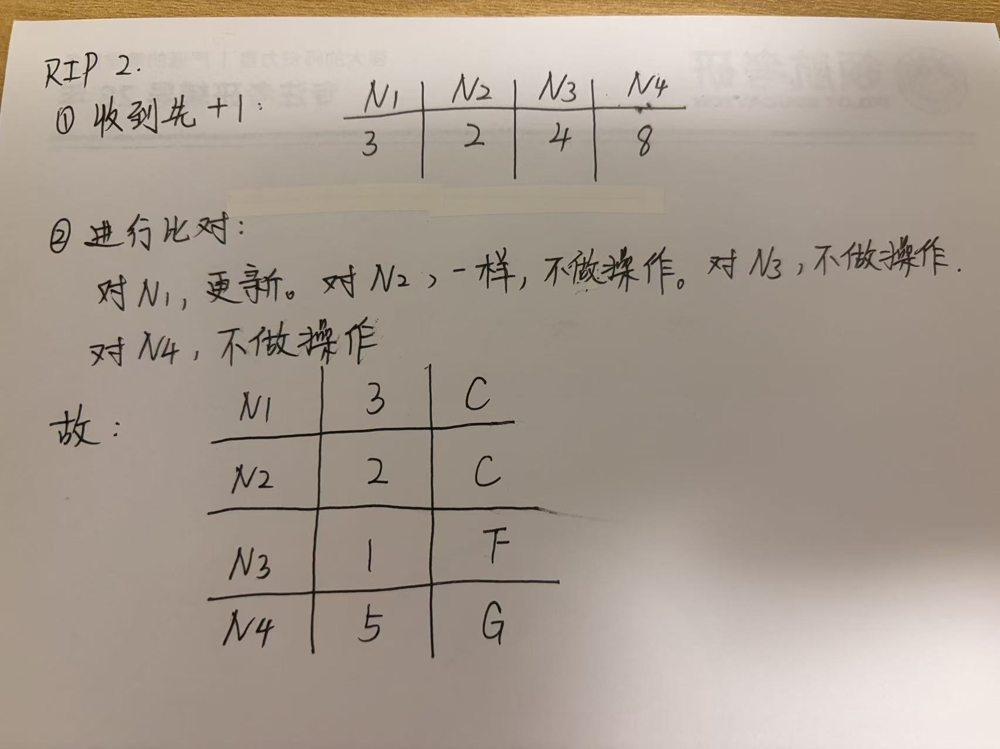


### 子网划分2

将网络地址为192.168.25.0的某C类网划分成4个子网，请计算出每个子网的有效的IP地址范围和对应的网络掩码（掩码用点分十进制表示）。


## 运输层

### TCP拥塞控制

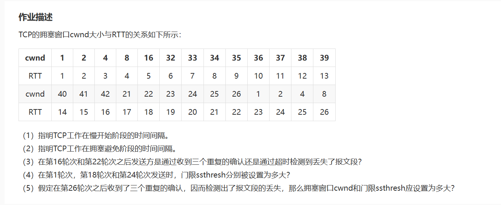


### UDP vs TCP

简答：为什么说UDP是面向报文的，而TCP是面向字节流的？

在计算机网络考试的简答题中，可以从**协议对应用层数据的处理方式**以及**是否保留报文边界**两个核心维度来作答：

1. UDP 是面向报文的（Message-Oriented）

- **处理方式**：发送方的 UDP 对应用程序交下来的报文，在添加首部后就**直接向下交付给 IP 层**，既不合并，也不拆分，而是**保留这些报文的边界**；接收方的 UDP 对 IP 层交上来的 UDP 用户数据报，在去除首部后就**原封不动地交付给上层应用进程**，一次交付一个完整的报文。
- **推论**：应用程序必须选择合适大小的报文。若报文太长，IP 层在传输时需要进行分片，降低传输效率；若报文太短，会使 IP 数据报的首部相对长度太大，降低有效载荷的利用率。

2. TCP 是面向字节流的（Byte-Stream-Oriented）

- **处理方式**：“流”指的是流入到进程或从进程流出的字节序列。TCP 把应用程序交下来的数据仅仅看成是一连串**无结构的字节流**，TCP 并不知道所传送字节的具体含义，也**不保留报文边界**。
- **解耦机制**：TCP 不保证接收方应用程序所收到的数据块与发送方应用程序所发出的数据块具有对应大小的关系（例如，发送方进程分 $10$ 次写入字节流，接收方进程可能分 $4$ 次就全部读出）。发送方 TCP 会根据**接收方给出的窗口值**和**当前网络拥塞程度**，自行决定一个报文段应包含多少个字节（可能将多个小数据块合并，也可能将一个大数据块拆分成多个报文段发送），但接收方应用程序收到的字节流必须与发送方应用程序发出的字节流**完全一样**。

### 简答拥塞控制

在TCP的拥塞控制中，发送方重传计时器的超时的情况下，会执行哪些步骤解决拥塞？

当 TCP 发送方的重传计时器超时（判定网络出现严重拥塞）时，会按顺序执行以下 5 个步骤来解决拥塞并恢复传输：

1. **更新慢开始门限（`ssthresh`）**：将新的慢开始门限设为发生超时那一刻拥塞窗口（`cwnd`）的一半，且不小于 $2$ 个最大报文段长度，即：

   $$\text{ssthresh} = \max(\text{cwnd} / 2,\ 2\text{ MSS})$$

2. **重置拥塞窗口（`cwnd`）**：将拥塞窗口立即减小为 **$1\text{ MSS}$**（即只允许发送 $1$ 个最大报文段，试探网络负载）。

3. **重传超时报文段并加倍超时时间（RTO 指数退避）**：立即重传已超时的未确认报文段；同时根据 Karn 算法，将重传计时器的超时时间（RTO）加倍，避免因网络持续拥塞而引发频繁重传。

4. **重新执行慢开始算法**：发送方重新进入**慢开始**阶段，每经过一个往返时间（RTT），将拥塞窗口 `cwnd` 指数级翻倍，直到 $\text{cwnd}$ 增长至新的门限值 $\text{ssthresh}$。

5. **切换至拥塞避免算法**：当 $\text{cwnd} = \text{ssthresh}$ 时，停止指数增长，转为执行**拥塞避免**算法，使拥塞窗口 `cwnd` 按线性规律缓慢增长（每经过 $1\text{ RTT}$ 增加 $1\text{ MSS}$），直到下一次拥塞发生或达到接收窗口上限。

## 应用层

这一层多数不会考主观题，只需要牢记如DNS，HTTP等重要概念即可。

## 综合应用题

（1）给出图中路由器R1的路由表。
（2）主机PC1向主机SERVER-A连续发送了两个TCP报文段，其序号分别为171和191。 试问：
    ①第一个报文段携带了多少个字节的数据？
    ②主机B收到第一个报文段后发回的确认中的确认号应当是多少？
    ③如果主机B收到第二个报文段后发回的确认中的确认号是261，试问A发送的第二个报文段中的数据有多少字节？
    ④如果A发送的第一个报文段丢失了，但第二个报文段到达了B。B在第二个报文段到达后向A发送确认。试问这个确认号应为多少？
（3）如果SERVER-A发给PC1的累积确认中rwnd=500，当前cwnd=300，试问PC1下一次发送窗口值应取值多少？


**拓扑如下：**该拓扑由两台路由器（左侧 `R2`、右侧 `R1`，型号均为 `Router-PT-Empty`）、四台二层交换机（`2950-24`）以及四台主机组成，整体分为左侧远端网段、中间广域网串口链路、右侧三个本地局域网段：   

一、 拓扑连接与接口参数

| **所属区域**       | **连接路径（由内向外）**                                     | **路由器接口**                                       | **关键 IP 地址与掩码**                         |
| ------------------ | ------------------------------------------------------------ | ---------------------------------------------------- | ---------------------------------------------- |
| **左侧远端网段**   | `R2`（左侧以太网口） $\leftrightarrow$ `交换机3` $\leftrightarrow$ `SERVER-A` | 未标注（作默认网关）                                 | `SERVER-A`：`145.13.170.1/23`                  |
| **中间广域网链路** | `R2`（右侧串口） $\leftrightarrow$ `R1`（左侧串口）          | `R2`：`S0/0`（或 `S3/0`）  `R1`：`S0/0`（或 `S3/0`） | `R2` 侧：`10.1.1.1/24`  `R1` 侧：`10.1.1.2/24` |
| **右侧上支网段**   | `R1` $\leftrightarrow$ `交换机0` $\leftrightarrow$ `PC0`     | `R1`：`Fa0/0`                                        | `PC0`：`145.13.0.1/18`                         |
| **右侧中支网段**   | `R1` $\leftrightarrow$ `交换机1` $\leftrightarrow$ `PC1`     | `R1`：`Fa1/0`                                        | `PC1`：`145.13.64.1/18`                        |
| **右侧下支网段**   | `R1` $\leftrightarrow$ `交换机2` $\leftrightarrow$ `PC2`     | `R1`：`Fa2/0`                                        | `PC2`：`145.13.128.1/18`                       |

二、 补充说明

- **未标注 IP 的以太网接口**：图中 `R1` 的 `Fa0/0`、`Fa1/0`、`Fa2/0` 以及 `R2` 连接 `交换机3` 的接口均未给出具体主机号，它们分别充当对应子网的默认网关，推导 `R1` 路由表时只需使用各网段的**网络地址**和**子网掩码**即可。   
- **题目中的“主机 B”**：第（2）题题干中提到的“主机 B”即接收方 `SERVER-A`（发送方 A 为 `PC1`）。   

```
                                                          ┌── Fa0/0 ── [SW0] ── [PC0] 145.13.0.1/18
                                                          │
[SERVER-A] ── [SW3] ── [R2] ══════════════════════ [R1] ──┼── Fa1/0 ── [SW1] ── [PC1] 145.13.64.1/18
145.13.170.1/23       S0/0: 10.1.1.1/24  S0/0: 10.1.1.2/24│
                                                          └── Fa2/0 ── [SW2] ── [PC2] 145.13.128.1/18
```

**图例说明：**

- **`SW0` ~ `SW3`**：对应原图中的四台 `2950-24` 二层交换机（`交换机0` ~ `交换机3`）。   
- **`══`**：表示路由器 `R2` 与 `R1` 之间的广域网串口（Serial）链路（接口编号可能为 `S0/0` 或 `S3/0`，不影响路由表结果）。   
- **`──`**：表示以太网双绞线链路，其中 `R1` 的 `Fa0/0`、`Fa1/0`、`Fa2/0` 分别为右侧三个子网的默认网关接口。   

