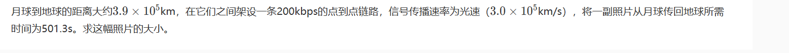
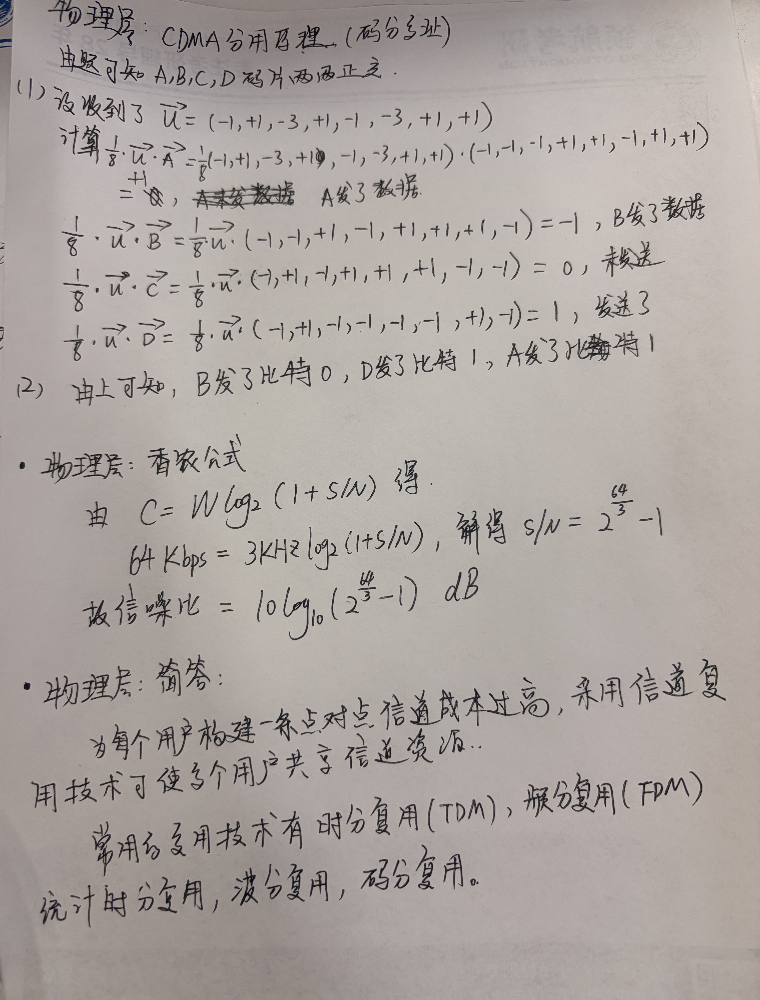
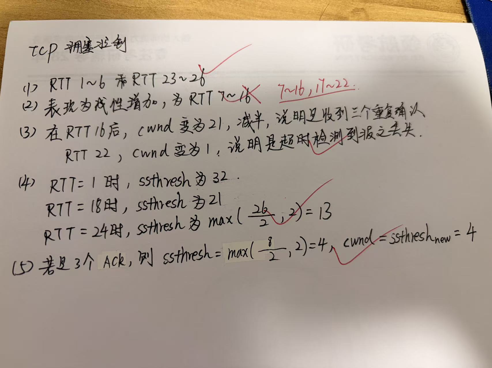

# 主观题

> [!IMPORTANT]
>
> 期末考试这些大题的类型必考，请务必按照题目自己先做一遍，再看答案。我们按照层次从低到高来。
>
> 配有我手写答案与AI确定(有的）的标准答案。

## 性能指标计算题

1. **计算传播时延（$t_{\text{传播}}$）** 已知月球到地球的距离 $d = 3.9 \times 10^5\text{ km}$，信号传播速率 $v = 3.0 \times 10^5\text{ km/s}$：   

   $$t_{\text{传播}} = \frac{d}{v} = \frac{3.9 \times 10^5\text{ km}}{3.0 \times 10^5\text{ km/s}} = 1.3\text{ s}$$

2. **计算发送时延（$t_{\text{发送}}$）** 已知照片传回地球所需的总时间 $t_{\text{总}} = 501.3\text{ s}$，减去传播时延即可得到纯发送数据所用的时间：   

   $$t_{\text{发送}} = t_{\text{总}} - t_{\text{传播}} = 501.3\text{ s} - 1.3\text{ s} = 500\text{ s}$$

3. **计算照片大小（$L$）** 链路带宽（发送速率）为 $R = 200\text{ kbps} = 200 \times 10^3\text{ bit/s}$，因此照片的总比特数为：   

   $$L = R \times t_{\text{发送}} = (200 \times 10^3\text{ bit/s}) \times 500\text{ s} = 1 \times 10^8\text{ bit}$$

1.发送时延：1e7bit/100kbps =100s
传播时延：1000km/ (2*1e8m/s) = 0.005s

2.发送时延：1e3bit/1Gbps = 1e-6s
传播时延： 1000km/ (2*1e8m/s) = 0.005s

## 物理层

- 共有四个站进行码分多址CDMA通信。四个站的码片序列分别为：
  A：(-1 -1 -1 +1 +1 -1 +1 +1)
  B：(-1 -1 +1 -1 +1 +1 +1 -1)
  C：(-1 +1 -1 +1 +1 +1 -1 -1)
  D：(-1 +1 -1 -1 -1 -1 +1 -1)
  现收到这样的码片序列：(-1 +1 -3 +1 -1 -3 +1 +1)。问：
  1）哪个站发送数据了？
  2）发送数据的站发送的是0还是1？
- 要用3KHz带宽的电话信道传送64Kbps的数据（无差错传输），试问这个信道应具有多高的信噪比（分别用比值和分贝来表示）？
- 为什么要使用信道复用技术？常用的信道复用技术有哪些？
- 

## 数据链路层

## 网络层

## 运输层

### TCP拥塞控制

### UDP vs TCP

简答：为什么说UDP是面向报文的，而TCP是面向字节流的？

在计算机网络考试的简答题中，可以从**协议对应用层数据的处理方式**以及**是否保留报文边界**两个核心维度来作答：

1. UDP 是面向报文的（Message-Oriented）

- **处理方式**：发送方的 UDP 对应用程序交下来的报文，在添加首部后就**直接向下交付给 IP 层**，既不合并，也不拆分，而是**保留这些报文的边界**；接收方的 UDP 对 IP 层交上来的 UDP 用户数据报，在去除首部后就**原封不动地交付给上层应用进程**，一次交付一个完整的报文。
- **推论**：应用程序必须选择合适大小的报文。若报文太长，IP 层在传输时需要进行分片，降低传输效率；若报文太短，会使 IP 数据报的首部相对长度太大，降低有效载荷的利用率。

2. TCP 是面向字节流的（Byte-Stream-Oriented）

- **处理方式**：“流”指的是流入到进程或从进程流出的字节序列。TCP 把应用程序交下来的数据仅仅看成是一连串**无结构的字节流**，TCP 并不知道所传送字节的具体含义，也**不保留报文边界**。
- **解耦机制**：TCP 不保证接收方应用程序所收到的数据块与发送方应用程序所发出的数据块具有对应大小的关系（例如，发送方进程分 $10$ 次写入字节流，接收方进程可能分 $4$ 次就全部读出）。发送方 TCP 会根据**接收方给出的窗口值**和**当前网络拥塞程度**，自行决定一个报文段应包含多少个字节（可能将多个小数据块合并，也可能将一个大数据块拆分成多个报文段发送），但接收方应用程序收到的字节流必须与发送方应用程序发出的字节流**完全一样**。

### 简答拥塞控制

在TCP的拥塞控制中，发送方重传计时器的超时的情况下，会执行哪些步骤解决拥塞？

当 TCP 发送方的重传计时器超时（判定网络出现严重拥塞）时，会按顺序执行以下 5 个步骤来解决拥塞并恢复传输：

1. **更新慢开始门限（`ssthresh`）**：将新的慢开始门限设为发生超时那一刻拥塞窗口（`cwnd`）的一半，且不小于 $2$ 个最大报文段长度，即：

   $$\text{ssthresh} = \max(\text{cwnd} / 2,\ 2\text{ MSS})$$

2. **重置拥塞窗口（`cwnd`）**：将拥塞窗口立即减小为 **$1\text{ MSS}$**（即只允许发送 $1$ 个最大报文段，试探网络负载）。

3. **重传超时报文段并加倍超时时间（RTO 指数退避）**：立即重传已超时的未确认报文段；同时根据 Karn 算法，将重传计时器的超时时间（RTO）加倍，避免因网络持续拥塞而引发频繁重传。

4. **重新执行慢开始算法**：发送方重新进入**慢开始**阶段，每经过一个往返时间（RTT），将拥塞窗口 `cwnd` 指数级翻倍，直到 $\text{cwnd}$ 增长至新的门限值 $\text{ssthresh}$。

5. **切换至拥塞避免算法**：当 $\text{cwnd} = \text{ssthresh}$ 时，停止指数增长，转为执行**拥塞避免**算法，使拥塞窗口 `cwnd` 按线性规律缓慢增长（每经过 $1\text{ RTT}$ 增加 $1\text{ MSS}$），直到下一次拥塞发生或达到接收窗口上限。

## 应用层

## 综合应用题

