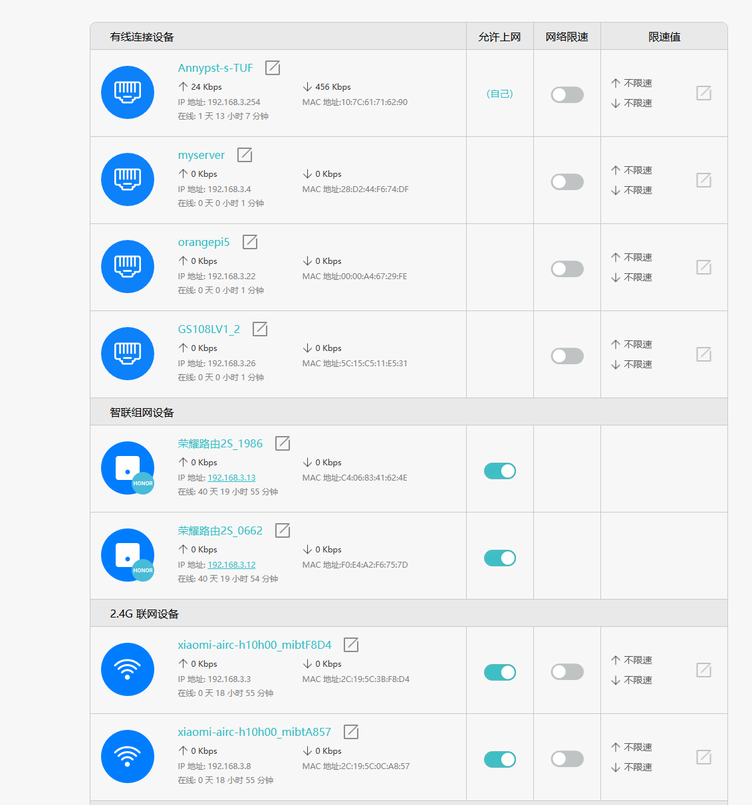

# 网络层26/10/14 课对应review

为了把网络层这一套知识体系彻底学透，我们将你列出的知识点按逻辑依赖关系划分为 **5 个递进阶段**，每次攻克一两个核心板块：

1. **第一阶段（本次讲解）**：网络层的核心使命 + IP 地址的本质（IPv4 与 IPv6 简要了解）
2. **第二阶段**：传统 IPv4 的分类编址（A/B/C/D/E 类）、网络号与主机号 + 各类特殊 IP 地址
3. **第三阶段**：子网划分（Subnetting）、子网掩码（Subnet Mask）与网关（Gateway）
4. **第四阶段**：无分类编址 CIDR、网络前缀、地址块（最小/最大地址、可分配服务器数量计算）
5. **第五阶段**：综合实战计算练习

下面我们正式开始 **第一阶段** 的内容。

### 一、 网络层（Network Layer）的核心使命

在上一章数据链路层中，我们已经有了 **MAC 地址** 和 **交换机**。一个自然的疑问是：**既然每张网卡都有全球（或相对）唯一的 MAC 地址，为什么不能直接用交换机把全世界的电脑连起来，还要多此一举发明网络层和 IP 地址？**

#### 1. 纯二层网络（数据链路层）无法覆盖全球的三大死穴

- **广播风暴灾难**：交换机不能隔离广播域。如果全世界几十亿台设备连在同一个二层网络中，只要有一台电脑发出一条 ARP 广播帧（`FF:FF:FF:FF:FF:FF`），全球所有交换机都会疯狂泛洪，所有电脑的 CPU 都会被广播中断直接打死。
- **MAC 地址是“扁平（Flat）”的，无法路由聚合**：MAC 地址就像人的**身份证号**（只标志你是哪个厂商生产的第几块卡，没有地理位置或拓扑规律）。如果买了一块网卡带到南极，全球的交换机要想找到你，必须在内存里存下全世界几十亿张网卡的精确映射表（CAM 表），没有任何硬件芯片能承受这种存储和查找开销。
- **底层异构物理网络无法互通**：数据链路层千差万别（以太网帧、Wi-Fi 802.11 帧、广域网光纤 PPP 帧格式完全不同），需要一个统一的逻辑层把它们屏蔽并粘合起来。

#### 2. 网络层的定位与设计哲学

- **核心职责**：实现**跨不同网络的“主机到主机（Host-to-Host）”逻辑通信**，负责路径选择（路由）与逻辑隔离。
- **协议数据单元（PDU）**：**分组 / IP 数据报（Packet）**。
- **代表性硬件设备**：**路由器（Router）**、三层交换机（负责阻断二层广播域，并在不同网段之间转发数据包）。
- **服务特征（向上层提供什么服务？）**：IP 协议提供的是**无连接的、不可靠的、尽最大努力交付（Best-Effort）的数据报服务**。
  - 网络层只管把数据包沿着路由表一跳一跳往前揣，**不保证不丢包、不保证按顺序到达、也不保证时延**。
  - **为什么这样设计？** 为了让核心路由器硬件结构极其简单、转发速度极快；至于丢包重传和顺序还原，全部推给端系统的第 4 层（传输层 TCP）去兜底。

### 二、 IP 地址、IPv4 与 IPv6 简要了解

#### 1. IP 地址的本质：层次化的逻辑地址

如果说 **MAC 地址是“身份证号”**（与物理硬件绑定，终身不变，扁平无规律），那么 **IP 地址就是“邮政编码 + 街道门牌号”**（与所处的网络拓扑位置绑定，具有严格的**层次性**）：

- 当你的笔记本电脑从家里拿到学校连接校园网时，网卡的 MAC 地址不变，但分配到的 **IP 地址会随之改变**。
- 数据包在跨网段传输时，每经过一个路由器，外层的**源/目的 MAC 地址都会被剥离并重新封装为下一跳的 MAC**；而包裹在里面的**源 IP 和目的 IP 地址自始至终保持不变**（除非经过 NAT 地址转换）。

#### 2. IPv4（Internet Protocol version 4）

IPv4 是目前互联网最基础、算题最核心的协议版本：

- **二进制位宽**：固定为 **32 位（32 bit，即 4 个字节）**。

- **地址总量**：$2^{32} = 4,294,967,296$（约 **42.9 亿**个）。

- **点分十进制记法（Dotted Decimal Notation）**：

  为了方便人类阅读，将 32 位二进制数按每 **8 位（1 字节）** 切成 4 段，每段独立转换为十进制整数，中间用英文句点 `.` 隔开：

  Plaintext

  ```
  二进制机器视角:  11000000 . 10101000 . 00000001 . 00000001  (共 32 bit)
                      |          |          |          |
  点分十进制视角:    192    .   168    .    1     .    1
  ```

- **单段数值范围**：因为每段是 8 个 bit，全 `0`（`00000000`）为 `0`，全 `1`（`11111111`）为 $2^8 - 1 = 255$。因此 IPv4 地址中每个数字的合法范围严格在 **`0 ~ 255`** 之间（看到 `192.168.1.256` 可直接断定为非法 IP）。

#### 3. IPv6（Internet Protocol version 6）简要了解

随着智能手机、物联网设备的爆发，42.9 亿个 IPv4 地址早已在全球分配殆尽。为了从根源上解决地址枯竭问题，IETF 推出了 IPv6（注：历史上的 IPv5 是一个实验性的流媒体协议，未作公网普及，故直接跳到了 v6）。

- **二进制位宽**：扩展到了 **128 位（128 bit，即 16 个字节）**，是 IPv4 长度的 4 倍。

- **地址总量**：$2^{128} \approx 3.4 \times 10^{38}$ 个（数量级极其庞大，足以给地球上的每一粒沙子都分配一个全球公网 IP）。

- **冒号十六进制记法（Colon Hexadecimal Notation）**：

  如果还用点分十进制写 16 个字节会极其冗长，因此 IPv6 将 128 位按每 **16 位（2 字节）** 分为一组，共分为 **8 组**；每组用 **4 个十六进制数**表示，组与组之间用冒号 `:` 隔开：

  $$\text{标准完整写法：} \quad \texttt{2001:0db8:0000:0000:0008:0800:200c:417a}$$

- **IPv6 的两大缩写规则（考试常考小题）**：

  1. **前导零省略**：每一组中开头的 `0` 可以直接省略（但不能全删空，全 `0` 至少要留一个 `0`）。
     - 上例去前导零后：$\texttt{2001:db8:0:0:8:800:200c:417a}$
  2. **双冒号零压缩（`::`）**：如果存在一組或多组连续的全 `0`，可以用一个双冒号 `::` 直接替代。
     - 上例零压缩后：$\texttt{2001:db8::8:800:200c:417a}$
     - **核心铁律**：在一个 IPv6 地址中，**双冒号 `::` 最多只能出现一次！**（如果出现两次，比如 `2001::88::1`，因为总固定是 8 组，计算机将无法判断前面省了几组 `0`、后面省了几组 `0`，产生二义性）。

| **比较维度**   | **IPv4**                                       | **IPv6**                                              |
| -------------- | ---------------------------------------------- | ----------------------------------------------------- |
| **地址长度**   | **32 bit**（4 字节）                           | **128 bit**（16 字节）                                |
| **书写格式**   | 点分十进制（4 段，`.` 分隔）                   | 冒号十六进制（8 组，`:` 分隔）                        |
| **首部格式**   | 变长首部（20~60 字节），路由器需计算首部校验和 | 固定基本首部（40 字节），取消首部校验和，硬件转发极快 |
| **配置与安全** | 依赖 DHCP 或手动配置；IPsec 为可选扩展         | 支持无状态自动配置（SLAAC，即插即用）；原生集成 IPsec |

在上一课我们建立了“IP 地址是逻辑层面的邮政编码”这一核心认知。现在进入**第二阶段**，我们将系统攻克经典 IPv4 的核心基石：**网络号与主机号的两级结构、传统的 A/B/C/D/E 分类编址，以及网络工程与考试中必考的各类特殊 IP 地址**。

### 一、 网络号（Net-ID）与主机号（Host-ID）

在最初设计 IPv4 时，互联网先驱们采用了**两级层次结构**，将 32 位的 IP 地址划分为两部分：

$$\mathbf{IP\ 地址} = \{\langle \text{网络号 Net-ID}\rangle, \langle \text{主机号 Host-ID}\rangle\}$$

#### 1. 为什么要划分为两级？（路由器的寻址哲学）

如果全世界 42 亿个 IP 都是扁平杂乱的，那么互联网上每一台核心路由器的路由表中，都必须记录 42 亿条“某某 IP 在哪个方向”的条目，这在硬件上是绝对无法实现的。

两级结构带来了路由转发的根本优化：

- **网络号（Net-ID）**：标识主机所连接到的**特定网络（或局域网广播域）**。在同一个物理网段或广播域内的所有设备，必须拥有**完全相同**的网络号。
- **主机号（Host-ID）**：标识该特定网络内部的**具体某台物理主机或路由器接口**。
- **路由表体积大幅压缩**：数据包在互联网骨干网转发时，沿途的路由器**只看网络号，不看主机号**。当且仅当数据包被最后一跳路由器送达目标网络后，该路由器才通过主机号交付给具体的设备。

### 二、 传统的 IPv4 分类编址（A、B、C、D、E 类）

为了适应不同规模的网络，早期制定了分类编址标准（Classful Addressing）。计算机区分一个 IP 属于哪一类，**完全取决于前几个比特（前导码）**：

Plaintext

```
A类: [0] (7位网络号)          | (24位主机号)
B类: [10] (14位网络号)        | (16位主机号)
C类: [110] (21位网络号)       | (8位主机号)
D类: [1110] (多播/组播组地址，无主机号)
E类: [1111] (保留给实验和科学研究)
```

#### 1. 各类地址的深度拆解与指标计算

| **类别** | **前导码** | **第一个字节范围** | **网络号位宽**   | **主机号位宽**   | **可用网络总数**                     | **每个网络的最大可用主机数**       |
| -------- | ---------- | ------------------ | ---------------- | ---------------- | ------------------------------------ | ---------------------------------- |
| **A 类** | `0`        | `1 ~ 126`          | 8 bit（1 字节）  | 24 bit（3 字节） | $2^7 - 2 = \mathbf{126}$             | $2^{24} - 2 = \mathbf{16,777,214}$ |
| **B 类** | `10`       | `128 ~ 191`        | 16 bit（2 字节） | 16 bit（2 字节） | $2^{14} = \mathbf{16,384}$           | $2^{16} - 2 = \mathbf{65,534}$     |
| **C 类** | `110`      | `192 ~ 223`        | 24 bit（3 字节） | 8 bit（1 字节）  | $2^{21} = \mathbf{2,097,152}$        | $2^8 - 2 = \mathbf{254}$           |
| **D 类** | `1110`     | `224 ~ 239`        | —                | —                | **多播（组播）地址**，用于一对多群发 |                                    |
| **E 类** | `1111`     | `240 ~ 255`        | —                | —                | **保留地址**，用于科学实验与科研     |                                    |

#### 2. 算题必须掌握的扣分陷阱：“为什么减 2？”

计算每个网段的**可用主机数**时，公式始终是 $2^n - 2$（$n$ 为主机号的比特数）：

- **必须减去的第 1 个地址（主机号全 0）**：保留为**网络地址**（代表该网络本身），不能分配给任何主机接口。
- **必须减去的第 2 个地址（主机号全 1）**：保留为**定向广播地址**，向该网络内所有主机群发数据，不能分配给具体主机。

> **A 类网络数为什么也是 $2^7 - 2 = 126$ 个？**
>
> 8 位网络号前缀占了 1 位（`0`），理论上有 $2^7 = 128$ 种取值：
>
> - 网络号全 `0`（`0.0.0.0` 系列）：保留表示“本网络”，不可作为公网网络号；
>
> - 网络号 `127`（`127.0.0.0` 系列）：被强制保留为**本地环回测试地址（Loopback）**。
>
>   因此扣除这 2 个后，A 类公网可用网络号严格为 **`1 ~ 126`**。

### 三、 各类特殊 IP 地址速查与物理内涵

在网络协议设计中，有若干特定的 IP 地址被赋予了特殊的系统功能，严禁当成普通公网单播地址使用：

Plaintext

```
+-----------------------+-----------------------------+------------------------------------+
| 特殊地址类型          | 具体地址 / 范围             | 核心用途与物理行为                 |
+-----------------------+-----------------------------+------------------------------------+
| 网络地址 (Net Address)| 主机号全 0                  | 代表某个网段整体，不可赋给网卡     |
| 定向广播 (Direct Bcast)| 主机号全 1                 | 向特定网段内所有主机广播           |
| 受限广播 (Local Bcast)| 255.255.255.255             | 向本局域网广播，路由器严格不转发  |
| 本地回环 (Loopback)   | 127.0.0.0 ~ 127.255.255.255 | 仅限本机协议栈自测，数据绝不出网卡 |
| 未指定地址 (This Host)| 0.0.0.0                     | DHCP 启动前的源 IP；或代表默认路由  |
| 自动私有地址 (APIPA)  | 169.254.0.0/16              | 电脑未获取到 DHCP 时系统自动临时兜底|
+-----------------------+-----------------------------+------------------------------------+
```

#### 1. 受限广播 vs 定向广播

- **受限广播（`255.255.255.255`）**：
  - **场景**：主机刚刚开机，甚至还不知道自己所在的网络号是什么（如发送 DHCP 发现报文）。
  - **行为**：以太网帧头填广播 MAC（`FF:FF:FF:FF:FF:FF`），IP 头填 `255.255.255.255`。
  - **边界**：**路由器绝对不会转发此类广播包**，它严格被死死锁死在当前的物理二层广播域之内[cite: 1]。
- **定向广播（直接广播，如 `192.168.1.255`）**：
  - **场景**：外部路由器将数据路由送到 `192.168.1.0/24` 这个网络后，最后一跳路由器发现主机号是全 1，便会将该包转化为局域网广播帧发给该网段的所有电脑。

#### 2. 本地回环地址（`127.0.0.1 ~ 127.255.255.254`）

- 最典型的就是 `127.0.0.1`（域名映射为 `localhost`）。
- **底层机制**：当你在电脑上向 `127.0.0.1` 发送数据时，操作系统内核协议栈会直接在**传输层/网络层内存缓冲区中将其掉头环回**，数据包**根本不会被推到物理网卡、更不会变成电脉冲发到网线外**。专用于单机开发调试与进程间通信。

### 四、 私有 IP 地址（Private IP，RFC 1918）

在分类编址中，如果不加控制，全球 42 亿个地址很快就会用完。为了缓解枯竭，IETF 在 A、B、C 类中各划出了**一段专门在内部局域网使用的私有地址**：

- **A 类私网地址**：`10.0.0.0 ~ 10.255.255.255`（共 **1 个** A 类网段，容量约 1677 万台，大型企业或数据中心专用）
- **B 类私网地址**：`172.16.0.0 ~ 172.31.255.255`（共 **16 个** 连续 B 类网段，中型企业校园网常用）
- **C 类私网地址**：`192.168.0.0 ~ 192.168.255.255`（共 **256 个** 连续 C 类网段，家用路由器如 `192.168.1.1` 最常见）

#### 私网地址的铁律

1. **公网路由器绝对不路由**：全球互联网的核心路由器，一旦收到目的 IP 属于私网地址的数据报，会**直接就地静默丢弃**。
2. **支持重复复用**：你家路由器内网是 `192.168.1.1`，邻居家内网也是 `192.168.1.1`，两者完全互不干扰。
3. **如何访问互联网？** 必须依靠家用路由器或防火墙上的 **NAT（网络地址转换）** 技术，把私网 IP 替换为电信运营商分配的合法公网 IP。

### 阶段小测（自检手感）

看到下面三个 IP，请快速在大脑中判决它们分别属于什么类别、能否作为公网服务器的合法地址：

1. `128.1.2.3`
2. `10.200.1.5`
3. `224.0.0.1`

*(参考答案：1 为 B 类公网合法地址；2 为 A 类保留的私网地址，不可直接用于公网；3 为 D 类组播地址，不可分配给单个主机。)*

以上是第二阶段的 **分类编址（A/B/C/D/E）、网络号/主机号与各类特殊 IP**。


## Subnet

现在进入**第三阶段**。在第二阶段中，我们看到了传统的 A/B/C 类编址将 IP 硬性分为两级（网络号 + 主机号）。这一阶段我们将攻克打破这种僵化格局的关键机制：**子网划分（Subnetting）、子网掩码（Subnet Mask）以及三层通信的核心枢纽——网关（Gateway）**。

### 一、 为什么需要子网划分？（两级分类编址的致命缺陷）

在早期的分类编址中，一个单位申请到一个网络号后，所有的主机号都属于同一个网段。这种机制在实际网络工程中暴露了三大死穴：

1. **地址空间极大浪费（颗粒度太粗）**：
   - 一个 B 类网络包含 $65,534$ 个可用 IP，一个 C 类网络只包含 $254$ 个可用 IP。
   - 如果一家企业有 500 台电脑，申请 1 个 C 类不够用；若向互联网机构申请 1 个 B 类地址，将闲置并浪费 65000 多个公网 IP。
2. **广播域过大无法隔离**：
   - 一个网络号对应一个广播域。如果一个单位内部几千台电脑都配置在同一个 B 类网络号下，任何一台电脑发送的 ARP 广播帧都会在全单位泛洪，极易诱发广播风暴。
3. **路由表条目迅速膨胀**：
   - 每一个独立网段都需要在互联网核心路由器中占一条路由记录。

为了解决上述问题，RFC 950 提出了**子网划分（Subnetting）**，将原本的两级结构改造成**三级层次结构**：

$$\mathbf{IP\ 地址} = \{\langle \text{网络号 Net-ID}\rangle, \langle \text{子网号 Subnet-ID}\rangle, \langle \text{主机号 Host-ID}\rangle\}$$

- **本质：向主机号“借位”**。一个单位向外依然只声明一个合法的网络号，但在单位内部，网管把主机号的高位拿出若干位来充当**子网号**，把一个大的物理网络在内部切割成多个互不相通的较小逻辑子网。
- **对外表现**：外界互联网核心路由器只看原始的网络号，根本不知道该单位内部划分了多少个子网；数据包只有被送达该单位的出口路由器后，该路由器才根据子网号进一步转发。

### 二、 子网掩码（Subnet Mask）与按位与（AND）运算

既然 IP 地址表面上看起来只是一串普通的 32 位点分十进制数字，**路由器和电脑操作系统怎么知道你到底借了几位做子网号？哪里是网络部分、哪里是主机部分？**

这就必须依赖与 IP 地址形影不离的工具——**子网掩码（Subnet Mask）**。

#### 1. 子网掩码的本质

子网掩码也是一个 32 位的二进制数字，其构造有严格的物理铁律：

- **网络号与子网号部分**：对应的所有二进制位**必须全为 `1`**；
- **主机号部分**：对应的所有二进制位**必须全为 `0`**；
- **形式特征**：二进制下必然是一串连续的 `1` 紧跟着一串连续的 `0`（绝对不可能出现 `1` 和 `0` 交叉穿插的非法掩码）。

#### 2. 未划分子网时的“默认子网掩码”

在没有借位划分的传统分类网络中，子网掩码严格遮盖默认的网络号：

- **A 类默认掩码**：前 8 位为 1 $\to$ `255.0.0.0`
- **B 类默认掩码**：前 16 位为 1 $\to$ `255.255.0.0`
- **C 类默认掩码**：前 24 位为 1 $\to$ `255.255.255.0`

#### 3. 核心数学运算：按位与（Bitwise AND）

无论是主机还是路由器，判断一个 IP 属于哪个子网，底层芯片采用的都是超高速硬件运算——**按位与（AND，符号 $\&$）**：

- 逻辑法则：$1\ \&\ 1 = 1$，$1\ \&\ 0 = 0$，$0\ \&\ 0 = 0$（即：**全 1 为 1，有 0 则 0**）。

- 核心公式：

  $$\text{子网网络地址} = \text{IP 地址} \ \& \ \text{子网掩码}$$

**手算演示**：

已知一台主机的 IP 为 `192.168.1.130`，子网掩码为 `255.255.255.192`，计算其所在的子网网络地址：

Plaintext

```
IP 地址 (192.168.1.130):   11000000 . 10101000 . 00000001 . 10000010
子网掩码 (255.255.255.192): 11111111 . 11111111 . 11111111 . 11000000
----------------------------------------------------------------------- (逐位执行 AND)
子网网络地址:              11000000 . 10101000 . 00000001 . 10000000
转换成点分十进制:           192     .   168    .    1     .   128
```

因此，该主机所在的子网网络地址是 **`192.168.1.128`**。

### 三、 网关（Gateway）与跨网段通信决策

#### 1. 什么是网关？

- **通俗比喻**：如果把一个子网看作一个带围墙的园区，所有内部人员互相对话只要在园区内喊一声（局域网 ARP 广播）即可；但如果你想跟外部其他园区的人写信，你必须先把信件送到园区的**大门传达室**，传达室的工作人员就是**网关（Gateway）**。
- **物理本质**：在现代 IP 网络中，**默认网关（Default Gateway）通常就是连接本局域网的路由器（或三层交换机）在本网段内的那个物理接口的 IP 地址**。
  - 比如家用 Wi-Fi 中，手机 IP 是 `192.168.1.100`，家用路由器 LAN 口的 IP 通常设为 `192.168.1.1`，这个 `192.168.1.1` 就是你的默认网关。

#### 2. 主机发送数据时的“两难决策”：直接发还是找网关？

当主机 A 准备向目的主机 B 发送一个 IP 数据包时，网卡和操作系统内核必须在毫秒内做出第一个关键决策：**B 跟我是同一个子网的邻居，还是远在天边的外网主机？**

操作系统内部遵循极其严密的判定逻辑：

Plaintext

```
                        [ 源主机准备发包 ]
                                |
       计算自身网络: 本机 IP  AND  本机子网掩码  ---> 网段 A
       计算目标网络: 目标 IP  AND  本机子网掩码  ---> 网段 B
                                |
                         网段 A == 网段 B ?
                               /  \
                       [是]  /      \  [否]
                           /          \
            【同网段通信】                【跨网段通信】
      1. 直接向局域网发 ARP 广播     1. 根本不找目的 IP 的 MAC！
         查询“目标 IP 的 MAC”           2. 向局域网发 ARP 广播查询
      2. 封装二层帧，目的 MAC 填         “网关 IP 的 MAC”
         目标主机 MAC                 3. 封装二层帧，目的 MAC 填
      3. 二层交换机直接送达               网关 MAC（目标 IP 仍保持不变）
                                      4. 扔给网关，由路由器向外路由转发
```

#### 常见工程误区提醒

在跨网段访问（例如电脑访问百度服务器 `180.101.50.242`）时：

- 产生的以太网帧头中，**目的 MAC 地址填的是网关路由器的 MAC 地址**，而不是百度的 MAC 地址；

- 剥开以太网帧头，内部包裹的 IP 数据报头中，**目的 IP 地址依然是百度的 IP 地址**。

  网关的作用就是二层的中转跳板。

### 阶段小结和疑问解答

子网划分通过**借位**实现了网络规模的灵活切割，**子网掩码**利用二进制按位与运算界定了网络号与主机号的边界，而**默认网关**则是设备跨越本子网与外部世界通信的必经出入口。

> [!NOTE]
>
> 好的，先解决几个疑问：1.我们说的处在一个子网、网络，在说什么？可以理解为这处在一个子网的端系统都在一个楼里的一户？那么这栋楼假如是一个公司，对外申请一个公网ip，那么这栋楼别的房间和该房间的ip不同子网有什么特点？能不能举例子感受下主机和该主机所处子网的ip写出来是什么样的？（展示一下网络号，子网号、主机号）2.我拿我的电脑执行arp -a,终端输出如下，给我通过这个实际运用讲解一下这与我们上面学习有什么关联。若你认为我的问题涉及后续学习的知识，可以说出来。PS C:\Users\Zhouh> arp -a
>
> 接口: 192.168.3.254 --- 0x9
>
>  Internet 地址     物理地址       类型
>
>  192.168.3.1      24-6f-8c-c4-92-67   动态
>
>  192.168.3.4      28-d2-44-f6-74-df   动态
>
>  192.168.3.12     f0-e4-a2-f6-75-7d   动态
>
>  192.168.3.13     c4-06-83-41-62-4e   动态
>
>  192.168.3.30     72-2b-a0-93-40-96   动态
>
>  192.168.3.31     ae-09-c5-b3-99-21   动态
>
>  192.168.3.235     dc-93-96-12-57-f5   动态
>
>  192.168.3.255     ff-ff-ff-ff-ff-ff   静态
>
>  224.0.0.2       01-00-5e-00-00-02   静态
>
>  224.0.0.22      01-00-5e-00-00-16   静态
>
>  224.0.0.167      01-00-5e-00-00-a7   静态
>
>  224.0.0.251      01-00-5e-00-00-fb   静态
>
>  224.0.0.252      01-00-5e-00-00-fc   静态
>
>  238.238.238.238    01-00-5e-6e-ee-ee   静态
>
>  239.255.255.250    01-00-5e-7f-ff-fa   静态
>
>  255.255.255.255    ff-ff-ff-ff-ff-ff   静态
>
> 接口: 198.18.0.1 --- 0x18
>
>  Internet 地址     物理地址       类型
>
>  198.18.0.2                 动态
>
>  198.18.0.3                 静态
>
>  224.0.0.2                  静态
>
>  224.0.0.22                 静态
>
>  224.0.0.251                 静态
>
>  224.0.0.252                 静态
>
>  239.255.255.250               静态
>
> 接口: 172.23.224.1 --- 0x3e
>
>  Internet 地址     物理地址       类型
>
>  172.23.231.92     00-15-5d-0d-c7-f5   动态
>
>  172.23.239.255    ff-ff-ff-ff-ff-ff   静态
>
>  224.0.0.2       01-00-5e-00-00-02   静态
>
>  224.0.0.22      01-00-5e-00-00-16   静态
>
>  224.0.0.251      01-00-5e-00-00-fb   静态
>
>  224.0.0.252      01-00-5e-00-00-fc   静态
>
>  238.238.238.238    01-00-5e-6e-ee-ee   静态
>
>  239.255.255.250    01-00-5e-7f-ff-fa   静态

### 一、 剖析“同一个子网”与大楼比喻

你用“**一栋楼里的一户/一个房间**”来类比子网，非常传神且切中网络设计的物理本质。

#### 1. “处于同一个子网/网络”到底在说什么？

在逻辑与物理层面，处于同一个子网意味着两件事：

- **二层直接可达**：所有设备处于同一个**二层广播域**内。如果主机 A 想找主机 B，它不需要出大门，直接在局域网内喊一嗓子（发送 ARP 广播），主机 B 就能听到并回复自己的 MAC 地址。它们之间的数据交换完全由二层交换机内部转发，**根本不需要经过路由器（网关）**。
- **网络号/子网号完全一致**：所有设备的 IP 地址经过各自的子网掩码做“按位与”运算后，得出的网络前缀完全相同。

#### 2. 如果这栋楼是一个公司，对外只有 1 个公网 IP，不同房间（子网）有什么特点？

如果这栋楼有财务部（301 房）、研发部（401 房），它们处于不同子网：

- **房间内部通信（同子网）**：财务部内的两台电脑传文件，直接在 301 房内通过部门交换机点对点通信，流量绝不会流到走廊或研发部。
- **跨房间通信（跨子网）**：财务部电脑想访问研发部的测试服务器，**哪怕物理线缆就挂在同一面墙上，也必须先发给 301 房门口的“门禁”（默认网关），由三层交换机/路由器在网络层拆包、查路由表后再投递进研发部**。
- **不同房间的广播完全隔离**：财务部电脑中毒引发的 ARP 欺骗或广播风暴，会被部门网关死死挡在 301 房内，绝不会波及研发部。
- **对外访问（NAT 机制，后续详学）**：整栋楼对外只有一个公网 IP。无论是财务部还是研发部的电脑访问百度，数据包流经大楼总出口路由器时，源私网 IP 都会被替换为大楼这唯一的公网 IP，外部互联网只能看到这栋楼，根本不知道楼里划分了多少个房间。

#### 3. 实例展示：主机和子网 IP 写出来长什么样？

假设公司申请到了一个 **B 类私网地址块 `172.16.0.0`**（默认掩码是 16 位：`255.255.0.0`）。

网管决定向主机号“借 8 位”来划分各个部门房间，此时子网掩码扩展为 **24 位（`255.255.255.0`）**：

$$\mathbf{IP\ 地址} = \{\langle \text{网络号 Net-ID (16位)}\rangle, \langle \text{子网号 Subnet-ID (8位)}\rangle, \langle \text{主机号 Host-ID (8位)}\rangle\}$$

我们以财务部的小张电脑（`172.16.1.5`）和研发部的小李电脑（`172.16.2.5`）为例进行二进制拆解：

Plaintext

```
【财务部小张的电脑: 172.16.1.5 / 24】
二进制形态:   10101100 . 00010000 . 00000001 . 00000101
字段归属:    [  网络号: 172.16  ] . [子网: 1 ] . [主机: 5 ]
             <--- 原 B 类网络号 --->   借用8位    剩余8位

* 小张所在的子网网络地址 (主机位全 0): 172.16.1.0   (代表财务部整个网络)
* 小张所在的子网广播地址 (主机位全 1): 172.16.1.255 (向财务部全员喊话)
* 该子网网关 IP (通常取第 1 个可用地址): 172.16.1.1 (财务部出门口)
```

Plaintext

```
【研发部小李的电脑: 172.16.2.5 / 24】
二进制形态:   10101100 . 00010000 . 00000010 . 00000101
字段归属:    [  网络号: 172.16  ] . [子网: 2 ] . [主机: 5 ]

* 小李所在的子网网络地址: 172.16.2.0
* 小李所在的子网广播地址: 172.16.2.255
* 该子网网关 IP:         172.16.2.1
```

- **对比结论**：小张和小李的 IP 前两段完全一样（`172.16`，代表在同一栋大楼/同一个企业大网），但第三段子网号不同（一个是 `1`，一个是 `2`）。当小张向小李发包时，小张的电脑拿掩码一算，发现目标网段是 `172.16.2.0` 不是自己的 `172.16.1.0`，因此小张电脑**绝不会直接去找小李的 MAC**，而是直接将以太网帧的目的 MAC 填为财务部门口网关 `172.16.1.1` 的 MAC，交给网关路由器去转发。

### 二、 解读你的终端 `arp -a` 输出：理论与工程实践的全面印证

在 Windows 执行的 `arp -a` 命令，打印的是操作系统内核维护的 **ARP 缓存表（IP 到 MAC 的映射关系）**。这一小段输出把你之前学到的物理层、数据链路层和网络层知识全部串联了起来：

#### 1. 物理局域网接口（你的真实家庭/办公网）

Plaintext

```
接口: 192.168.3.254 --- 0x9
  Internet 地址          物理地址              类型
  192.168.3.1            24-6f-8c-c4-92-67     动态
  192.168.3.4            28-d2-44-f6-74-df     动态
  ...
  192.168.3.255          ff-ff-ff-ff-ff-ff     静态
  224.0.0.2              01-00-5e-00-00-02     静态
  ...
  255.255.255.255        ff-ff-ff-ff-ff-ff     静态
```

- **你的本机 IP 是什么？**

  - `接口: 192.168.3.254`：说明你的网卡在本网段分到的 IP 是 `192.168.3.254`。

- **谁是你的默认网关？**

  - 表项第一行 `192.168.3.1`，其 MAC 地址是 `24-6f-8c-c4-92-67`。这正是你的**局域网无线路由器（LAN 口）**。当你访问外网所有网站时，以太网帧头的目的 MAC 填的全是这个 `24-6f-8c-c4-92-67`。

- **广播地址与全 F MAC 的严格绑定**：

  - `192.168.3.255`（本子网定向广播）和 `255.255.255.255`（受限广播），它们对应的物理地址**全部都是静态写死的 `ff-ff-ff-ff-ff-ff`**！这与我们在以太网 MAC 帧中学到的“广播帧目的 MAC 必须是全 F”完全吻合。

- **组播 IP 到组播 MAC 的转换规律（严密对应）**：

  - 注意这几行：

    - `224.0.0.2` $\to$ `01-00-5e-00-00-02`

      

    - `224.0.0.22` $\to$ `01-00-5e-00-00-16`（注意：十进制的 22 换算成十六进制正好是 `0x16`！）

    - `224.0.0.251` $\to$ `01-00-5e-00-00-fb`（十进制的 251 换算成十六进制正好是 `0xfb`，这是局域网 mDNS 设备发现协议）

    - `239.255.255.250` $\to$ `01-00-5e-7f-ff-fa`（局域网 SSDP 简单服务发现协议）

  - **完全印证上一节**：组播 MAC 的前 24 位固定是 **`01-00-5e`**，第 25 位为 0，后 23 位直接把 IP 地址映射进来！操作系统在本地自动帮你建好了这些静态映射，不需要再发 ARP 请求。

#### 2. 另外两个神秘接口（涉及后续知识：虚拟化与代理）

你的电脑上还出现了另外两个接口，这印证了一个核心概念——**IP 地址不是绑定在“电脑铁壳”上的，而是绑定在“网络适配器（物理网卡或虚拟网卡接口）”上的**：

- **接口 `198.18.0.1`**：
  - **背后的应用**：你电脑上大概率开启了类似 Clash、v2rayN、Surge 等网络代理工具的 **TUN 虚拟网卡模式**。
  - **涉及后续知识**：`198.18.0.0/15` 是 RFC 2544 专门保留用于**网络设备基准性能测试（Benchmark）的特殊保留地址块**。代理软件为了防止内网 IP 冲突，巧妙借用了这一段冷门保留 IP 来接管你的全机外网流量。
- **接口 `172.23.224.1`**：
  - **背后的应用**：你电脑上运行了 **WSL2（Windows Subsystem for Linux）** 或者开启了 **Hyper-V 虚拟机 / Docker**。
  - **细节印证**：注意其下的条目 `172.23.231.92` 对应的 MAC 是 `00-15-5d-0d-c7-f5`。根据上一章学的 IEEE OUI 规则，**`00-15-5D` 是微软（Microsoft Corp）专门注册的专属厂商代码**！专门用于给 Hyper-V 虚拟机分配虚拟网卡。
  - **提前剧透第四阶段的核心（子网划分）**：
    - 看它的广播地址：`172.23.239.255  ff-ff-ff-ff-ff-ff`。
    - 为什么这里的广播地址不是 `.255.255`，也不是单纯的 `.224.255`，而是奇奇怪怪的 **`239.255`**？
    - 这正说明微软虚拟网卡使用的是**非标准的变长子网掩码（CIDR，网络前缀是 `/20`）**！计算得出的这个子网地址块范围就是从 `172.23.224.0` 到 `172.23.239.255`。

通过这次动手执行 `arp -a`，你已经亲眼见证了“IP 逻辑地址”是如何落地映射为“MAC 物理硬件地址”的，以及特殊广播、组播在系统底层的真实存在形式。

> [!NOTE]
>
> 假如研发部子网网络地址： 172.16.2.0,广播是 172.16.2.255，网关 172.16.2.1，那么是不是研发部还可以容纳 172.16.2.2~ 172.16.2.254 这些设备？也就是这个网络中可以容纳的员工端系统数量？

在一个掩码为 24 位（即 `255.255.255.0`）的子网中，地址空间的分配与可用设备数量可以按以下步骤拆解推导：

#### 1. 地址块总数与保留地址扣除

该子网的主机号位宽为 8 位，包含的全部 IP 地址总数为：

$$2^8 = 256 \text{ 个（范围为 172.16.2.0 至 172.16.2.255）}$$

根据 IP 协议规范，必须预先扣除两个系统保留地址：

- **网络地址**：`172.16.2.0`（主机位全 0，代表该子网本身，不可分配给任何物理网卡）
- **定向广播地址**：`172.16.2.255`（主机位全 1，用于本网段全员广播，不可分配给单个设备）

扣除这 2 个保留地址后，该子网理论上可供网络接口配置的**全部可用主机 IP 地址池**为：

$$\text{可用主机 IP 范围}：\mathbf{172.16.2.1 \sim 172.16.2.254}\text{，共 } 256 - 2 = \mathbf{254 \text{ 个}}$$

#### 2. 网关占用的地址扣除

网关并不是凭空存在的虚拟概念，它是连接研发部交换机的**路由器（或三层交换机）物理接口**。为了能与研发部内的员工电脑直接在二层通信，这个接口自身必须占用该网段内的一个合法主机 IP。

工程实践中通常默认将可用区间的第 1 个地址（即 `172.16.2.1`）分配给网关。

#### 3. 员工端系统容量计算

在扣除了网关接口占用的 `172.16.2.1` 之后，剩余留给终端主机分配的地址范围确为：

$$\mathbf{172.16.2.2 \sim 172.16.2.254}$$

其包含的有效 IP 数量为：

$$254 - 2 + 1 = \mathbf{253 \text{ 个}}$$

在局域网内没有其他公共网络设备（如部门共享网络打印机、无线 AP 接入点、门禁打卡机等）占用 IP 的前提下，每一个员工端系统（台式机、笔记本、测试手机等）接入网络都需要消耗一个独立的 IP。因此，该子网最大能够容纳的员工端系统上限就是 253 台。

## CIDR 地址块 分配计算

无分类域间路由选择 **CIDR（Classless Inter-Domain Routing）** 彻底废除了传统的 A、B、C 类分类体系与两级地址结构，将 IPv4 推进到了现代灵活的**任意前缀编址**时代。

### 一、 CIDR 的产生背景与斜线记法（网络前缀）

在分类编址时代，B 类地址（容量 6.5 万）迅速被申请一空，而 C 类地址（容量 254）又无法满足稍大企业的需求，同时全球骨干路由器的路由表条目因网段过多而呈现指数级爆炸。1993 年推出的 CIDR 从底层重构了 IP 地址的划分逻辑。

#### 1. 结构变革：网络前缀替代传统网络号

CIDR 将 32 位 IPv4 地址重新定义为两级结构：

$$\mathbf{IP\ 地址} = \{\langle \text{网络前缀 Network-Prefix}\rangle, \langle \text{主机号 Host-ID}\rangle\}$$

- **打破字节对齐限制**：网络前缀的长度不再被锁死在 8 位、16 位或 24 位，而是可以是 **$1 \sim 31$ 之间的任意整数**。
- **掩码的唯一决定权**：既然没有了 A/B/C 类的默认界限，**离开前缀长度或子网掩码，单纯的一个 IP 地址在现代网络中没有任何路由意义**。

#### 2. 斜线记法（Slash Notation）

为了替代冗长的“IP 地址 + 点分十进制子网掩码”，CIDR 引入了在 IP 之后追加斜线和前缀位数的记法：

$$\text{形式：} \quad \texttt{a.b.c.d / n}$$

- **$n$（前缀长度）**：代表从最左侧开始连续有 $n$ 个二进制位为 `1`。
- **对应掩码换算**：
  - `/24` $\implies$ 前 24 位全 1 $\implies$ `255.255.255.0`
  - `/16` $\implies$ 前 16 位全 1 $\implies$ `255.255.0.0`
  - `/28` $\implies$ 前 24 位 + 4 位全 1（`11110000`） $\implies$ `255.255.255.240`

### 二、 CIDR 地址块的核心指标与推导公式

网络前缀相同的连续 IP 地址集合构成一个 **CIDR 地址块（Address Block）**。给定任意一个 CIDR 形式的网段 `a.b.c.d/n`，其全部计算均由主机位数 $h = 32 - n$ 推导得出：

Plaintext

```
|<------------- n 位网络前缀 ------------->|<--- h = (32 - n) 位主机号 --->|
[ 1  0  1  0  ...  ...  ...  0  1  1  0 ] [ 0  0  0  ...  ...  ...  0  0 ] -> 最小地址 (网络地址)
[ 1  0  1  0  ...  ...  ...  0  1  1  0 ] [ 1  1  1  ...  ...  ...  1  1 ] -> 最大地址 (定向广播)
```

| **核心指标**             | **数学公式 / 计算法则**                                      | **物理含义与约束**                         |
| ------------------------ | ------------------------------------------------------------ | ------------------------------------------ |
| **主机号位宽 $h$**       | $h = 32 - n$                                                 | 地址块内可自由分配的比特位数               |
| **地址块包含的 IP 总数** | $N_{\text{total}} = 2^h = 2^{32 - n}$                        | 该网段覆盖的全部物理与逻辑地址量           |
| **最小地址（网络地址）** | 前缀 $n$ 位保持不变，主机号 $h$ 位**全置为 0**               | 代表该网络本身，**不可分配给任何网卡**     |
| **最大地址（定向广播）** | 前缀 $n$ 位保持不变，主机号 $h$ 位**全置为 1**               | 用于向该网段所有主机发送广播，**不可分配** |
| **最大可分配服务器数量** | $N_{\text{usable}} = 2^{32 - n} - 2$                         | 扣除网络地址和广播地址后的纯主机容量       |
| **可用主机 IP 分配区间** | $\mathbf{[\text{最小地址} + 1 \quad \sim \quad \text{最大地址} - 1]}$ | 实际可给终端、服务器、网关配置的合法范围   |

*(注：如果在真实生产架构中，该子网需要与外网通信，网关接口还会固定占用该区间内的 1 个 IP，此时实际留给普通服务器的上限为 $2^{32-n} - 3$ 个。)*

### 三、 实例推导：解密你终端里的 Hyper-V 虚拟子网

在第二阶段中，你的 `arp -a` 输出里出现了一个广播地址为 `172.23.239.255` 的虚拟接口 `172.23.224.1`。现在用 CIDR 的完整计算流程来还原这个网络的设计：

**【已知条件】** 该虚拟网卡所在的 CIDR 地址块为：**`172.23.224.0/20`**。

#### 1. 计算主机位与 IP 总数

- 前缀长度 $n = 20$；
- 主机号位数 $h = 32 - 20 = 12$ 位；
- 该地址块的 IP 总数：$2^{12} = \mathbf{4096}$ 个。

#### 2. 将第三个字节展开为二进制，寻找边界

地址的前两个字节 `172.23` 占满前 16 位；因此第 17 至 20 位（共 4 位）落在第三个字节中：

- 第三个字节十进制为 224，化为二进制：`1110 0000`

- 按照前缀 20 位切分（前 4 位属于前缀，后 4 位属于主机号）：

  $$\text{第三字节} = [\mathbf{1110}]_{\text{前缀}} \quad [\mathbf{0000}]_{\text{主机位}}$$

#### 3. 确定最小地址与最大地址

- **最小地址（网络地址，主机位全 0）**：
  - 第三字节：`1110 0000` $\to 224$
  - 第四字节：主机位 8 位全 0 $\to 0$
  - 得到网络地址：**`172.23.224.0`**
- **最大地址（定向广播地址，主机位全 1）**：
  - 第三字节：`1110 1111` $\to 224 + 15 = 239$
  - 第四字节：主机位 8 位全 1 $\to 255$
  - 得到定向广播地址：**`172.23.239.255`**（**完全吻合你此前 `arp -a` 打印出的底层物理数据**）

#### 4. 可用服务器数量与分配区间

- **可分配服务器（端系统）总数**：$2^{12} - 2 = 4096 - 2 = \mathbf{4094}$ 台。

- **合法主机 IP 分配区间**：`172.23.224.1 ~ 172.23.239.254`。

  *(其中 Windows 自动选取了第一个地址 `172.23.224.1` 充当宿主机虚拟交换机的网关接口)*。

### 四、 路由聚合（超网 Supernetting）

CIDR 不仅可以向下把大网络细分，更关键的能力在于向上把多个连续的小网络合并，这被称为**路由聚合（Route Aggregation）\**或\**构成超网**。

#### 核心作用：缩减骨干路由器转发表

假设某 ISP 旗下有 4 个连续的 C 类网络分配给了同一个园区的不同部门：

- `192.168.0.0/24`
- `192.168.1.0/24`
- `192.168.2.0/24`
- `192.168.3.0/24`

如果不聚合，全球公网路由器必须分别存储 4 条路由记录。使用 CIDR 提取它们的公共二进制前缀：

Plaintext

```
192.168.000000 00 . 0  (/24)
192.168.000000 01 . 0  (/24)
192.168.000000 10 . 0  (/24)
192.168.000000 11 . 0  (/24)
----------------------
前 22 位完全一致: 192.168.0.0/22
```

对外广播时，路由器只需发布一条 **`192.168.0.0/22`** 的聚合路由，就可以直接代表这 4 个网段，路由表体积瞬间缩减了 75%。

## 答疑

> [!NOTE]
>
> 好的，先解答疑问，既然192.168.0.0代表这个网络而不分配任何设备，那么与192.168.0.0通讯会发生什么？如果网关是192.168.0.1，那么是不是一般访问，会跳转到路由器管理页面？以及既然对外仅仅暴露一个**192.168.0.0/22** 的聚合路由，那么外界如何与该网络中指定设备通讯？

### 一、 与网络地址（如 `192.168.0.0`）通信会发生什么？

如果你在电脑终端尝试与主机号全 0 的网络地址通信（例如执行 `ping 192.168.0.0`），数据在绝大多数情况下会**被系统直接拦截或丢弃**，通信无法正常建立。

这一现象由两个层面的机制决定：

#### 1. 链路层层面：ARP 解析彻底失败

- 要发送单播以太网帧，发送端必须通过 ARP 协议获取目的 IP 对应的 MAC 地址。
- 但全球任何合规的操作系统，在网卡配置静态 IP 或通过 DHCP 获取 IP 时，**底层驱动都严格禁止配置主机号全 0 的地址**。
- 既然局域网内没有任何一台主机持有 `192.168.0.0` 这个 IP，发送端发出的 ARP 请求就**永远不会收到任何响应**，最终在几秒后报出 `Destination Host Unreachable`（目标主机不可达）。

#### 2. 操作系统协议栈与历史遗留差异

- **现代操作系统（如 Windows 10/11）**：内核网络栈在封装阶段检测到目的 IP 为网络地址，通常会直接在本地拒绝发包，提示 `PING: 传输失败。常见故障。`。
- **Linux / Unix 与早期历史遗留**：在 1980 年代早期的 BSD 网络协议栈中，主机位全 0 曾一度被当作**广播地址**使用（后来 RFC 规范统一将全 1 定为定向广播）。因此，在部分 Linux 系统中 ping 网络地址，系统可能会将其当作广播发送，偶尔能收到本网段内部分老旧 Linux 主机的回复，或者直接提示 `Do you want to ping broadcast?`。

### 二、 访问网关 `192.168.0.1` 会跳转到路由器管理页面吗？

在家用场景下确实如此，但这并不是网关的“协议本能”，而是**硬件厂商在应用层捆绑的功能**。

#### 1. “网关”与“管理后台”是不同层次的概念

- **网络层（L3）的网关**：网关的本职工作是在三层转发 IP 数据包。从网络协议来看，网关只需要具备一个 IP 和 MAC，能够把内网的数据包改写二层帧头并扔给外网即可，它**根本不需要提供任何网页界面**。
- **应用层（L7）的管理后台**：家用路由器（如 TP-Link、小米、华为）为了让普通用户能够图形化配置 Wi-Fi 密码和上网拨号，在其嵌入式系统内部同时运行了一个轻量级的 Web 服务器（如 Nginx、Lighttpd 或 uHTTPd），监听了 HTTP（80）或 HTTPS（443）端口。

#### 2. 不同网络环境下的表现差异

- **家用/SOHO 路由器**：浏览器输入 `[http://192.168.0.1](http://192.168.0.1)` 时，发起的 TCP 握手请求正好被该内置 Web 服务接收，因此会弹出路由器登录管理页面。
- **企业级 / 工业级核心网关**：在企业交换机、机房大型路由器或防火墙中，出于安全考虑，网关接口的 Web 服务默认是**彻底关闭**的。如果你在公司浏览器里直接输网关 IP，只会收到“连接被拒绝（Connection Refused）”或超时，网络管理员通常只能通过 SSH（22 端口）、Console 串口线或专用管理 VLAN 登录配置。

### 三、 对外仅暴露一个聚合路由（`/22`），外界如何与指定设备通信？

这是计算机网络设计中最精妙的机制之一：**骨干网络看粗路由，边缘网络看细路由（逐级解聚与分层递送）**。

#### 1. 宏观流程：邮政快递类比

假设有人从美国给你寄快递，地址写着：`中国北京市海淀区中关村南大街 1 号 302 室`：

- **国际干线（骨干路由器视角）**：美国的货运飞机和国际中转站根本不关心海淀区或 302 室在哪，分拣系统只看前缀——`中国`（相当于 `/22` 的聚合大路由），飞机直接把集装箱拉到北京首都机场；
- **末端配送（本地路由器视角）**：集装箱落地北京海关后，本地配送网点拆包，看更长更细的地址——海淀区 $\to$ 中关村街道（相当于局部的 `/24` 明细路由），最终由片区快递员拿着包裹敲响 302 室的门。

#### 2. 网络层真实转发机制（公网环境）

假设某个机构拥有聚合地址块 `192.168.0.0/22`，外界某台主机想访问该机构内部的特定服务器 `192.168.2.55`：

Plaintext

```
[ 外部源主机 ]
      |  (发出的 IP 数据报：目的 IP 始终精准写着 192.168.2.55)
      v
[ 互联网骨干路由器集群 ]
      |  (路由表条目极其精简，只匹配 192.168.0.0/22)
      |  (将数据包一路接力推送至该机构的边界路由器 R1)
      v
[ 机构边界路由器 R1 ]
      |  (展开内部明细路由表，按“最长前缀匹配”解聚查找)
      |-- 192.168.0.0/24 --> 端口 1 (研发部)
      |-- 192.168.1.0/24 --> 端口 2 (财务部)
      |-- 192.168.2.0/24 --> 端口 3 (服务器机房)  <-- 命中该接口！
      |-- 192.168.3.0/24 --> 端口 4 (访客网络)
      v
[ 机房三层交换机 ]
      |
      | (目的 IP 192.168.2.55 与本机处于同一网段，发起 ARP 查询)
      v
[ 目标服务器 (192.168.2.55) ]
```

- **IP 数据报本身从未改变**：在整个传输过程中，IP 头部里的“目的 IP 地址”始终是完完整整、精确到末位的 `192.168.2.55`。
- **聚合路由只影响“导航”精度**：外面的骨干网只看前 22 位，确保用最小的路由表把包送到大门口；大门口的边界路由器 R1 内部保留着详细的 `/24` 内部拓扑，由它根据末尾的比特把包精确分流到对应的子网中。

#### 3. 补充说明：如果是私网地址（NAT 场景）

由于 `192.168.0.0` 本身属于 RFC 1918 私网网段，如果在真实互联网中：

- 公网路由器根本不会转发以 `192.168.x.x` 为目的 IP 的数据包。
- 外网想主动访问内网服务器，必须在该机构的出口网关上配置 **端口映射（DNAT / Port Forwarding）**，例如将 `公网 IP:8080` 映射到内部的 `192.168.2.55:80`，外界通过公网 IP 和特定端口来实现穿透访问。

> [!NOTE]
>
> 1.我在本地调试我的web作品，通常访问127.0.0.1:3000来查看效果,那么127.0.0.0是指本地机器的网络吗？2.192.168.0.0/22这么一串，是指IP还是网络还是主机，如果给你个192.168.0.0/22，它究竟代表什么？

### 一、 `127.0.0.0` 是指本地机器的网络吗？

**是的，`127.0.0.0` 精确代表“本地环回网络（Loopback Network）”这个网络本身。**

#### 1. `127.0.0.0/8`：一整个属于本机的 A 类网段

在 IPv4 的分类编址体系中，整个以 `127` 开头的网段（网络前缀为 8 位的 `127.0.0.0/8`）全部被 IANA 强制保留为**本地环回网络**：

- **网络地址**：`127.0.0.0`（代表这个环回网络整体，主机位全 0）。
- **广播地址**：`127.255.255.255`（该环回网络的广播，主机位全 1）。
- **可用主机地址池**：`127.0.0.1 ~ 127.255.255.254`，总计拥有多达 **$2^{24} - 2 = 16,777,214$ 个地址**。

#### 2. `127.0.0.1` 只是其中的“沧海一粟”

你在开发中访问的 `127.0.0.1:3000`，只是操作系统在这个拥有 1600 多万个 IP 的环回网络中，**约定俗成默认使用的第 1 个单播主机地址**。

> **工程冷知识**：
>
> 操作系统内核将整个 `127.0.0.0/8` 地址块全部绑定在了一个叫作 `lo`（Loopback）的虚拟网卡上。
>
> 只要你的 Web 服务监听的是全接口 `0.0.0.0:3000`，你在浏览器中输入 `[http://127.0.0.2:3000](http://127.0.0.2:3000)`、`[http://127.1.2.3:3000](http://127.1.2.3:3000)`，甚至 `[http://127.254.254.254:3000](http://127.254.254.254:3000)`，**全部都能正常打开你的网页**。它们在操作系统协议栈内部都会被当成“发往本机”而直接环回。

### 二、 `192.168.0.0/22` 是指 IP、网络还是主机？

**它代表一个“网络”（严格来说是一个 CIDR 地址块 / 路由前缀），绝对不是一台主机，也不能单独作为普通主机的 IP 来使用。**

#### 1. 为什么断定它是“网络”而不是“主机”？

看它的**主机号二进制位**：

- 斜线后是 `/22`，意味着前 22 位是网络前缀，剩下的主机位数为 $32 - 22 = 10$ 位。

- 将 `192.168.0.0` 的后半段展开成二进制：

  $$\text{第三字节 (0)} = \mathbf{000000}00_2 \qquad \text{第四字节 (0)} = 00000000_2$$

- 按照前 22 位划分边界：

  Plaintext

  ```
  前 22 位网络前缀:   11000000.10101000.000000  (192.168.0.)
  后 10 位主机号:                            00 . 00000000  (全为 0！)
  ```

因为其 **10 位主机号全部为 0**，根据协议定义，**主机号全 0 的形态只能代表网络地址**，因此它指代的是一个网络。

#### 2. 如果给你一个 `192.168.0.0/22`，它究竟代表什么？

在网络工程师和路由器眼里，这一串字符包含了该网络的全部物理规格：

- **对应的子网掩码**：前 22 位全 1，即 `11111111.11111111.11111100.00000000` $\implies$ **`255.255.252.0`**。

- **涵盖的 IP 地址总数**：$2^{10} = \mathbf{1024}$ 个 IP。

- **地址块的精确物理边界**：

  - **网络地址（最小地址）**：前缀不变，主机位全 0 $\implies$ **`192.168.0.0`**
  - **定向广播（最大地址）**：前缀不变，主机位全 1 $\implies$ 后 10 位变为 `11.11111111`（第三字节加 3，第四字节为 255） $\implies$ **`192.168.3.255`**

- **可用主机/服务器 IP 范围**：

  $$\mathbf{192.168.0.1 \sim 192.168.3.254}$$

- **可分配服务器的最大数量**：$1024 - 2 = \mathbf{1022}$ 台（扣除网络地址与广播地址）。

- **拓扑意义（路由聚合）**：

  它代表将 4 个原本连续的传统 C 类网络（`/24`）在逻辑上**合并（聚合）成了一个大局域网**：

  - `192.168.0.0/24`

  - `192.168.1.0/24`

  - `192.168.2.0/24`

  - `192.168.3.0/24`

    处于 `192.168.0.5` 和 `192.168.3.50` 的两台电脑，在 `/22` 的掩码下被判定为**处于同一个子网**，彼此通信不需要经过网关路由器，直接二层发 ARP 即可通信。

这两个概念的底层逻辑已经彻底清晰。至此，从 IP 基础、分类编址、特殊 IP、子网掩码到 CIDR 的全部理论基石已全部打通。

## 例题

### 第五阶段：综合实战计算练习

在掌握了分类编址、子网掩码、CIDR 与网关路由的全部理论后，进入实战演练。在网络工程与考研统考（如 408）、华为/思科认证中，网络层的计算主要聚焦在三类核心题型：**容量驱动的子网规划**、**任意非对齐 CIDR 边界速算**，以及**路由器的最长前缀匹配决策**。

### 实战一：企业子网规划与可用主机测算（需求驱动）

**【题目情境】**

某企业申请到了一个公网 C 类地址块 **`192.168.10.0/24`**。现企业内部规划建设 4 个独立的部门局域网，且要求**每个部门能够容纳至少 25 台服务器/主机**。

1. 请给出满足该需求的最佳子网掩码（点分十进制与斜线记法）。
2. 写出划分出的 4 个子网的网络地址、有效主机 IP 范围及定向广播地址。
3. 每个子网最多还能再扩容多少台服务器？

#### 详细推导与解题步骤

**第一步：确定需要向主机号借用的位数 $m$**

- 原始网络前缀为 `/24`，剩余的主机位总共为 $32 - 24 = 8$ 位。

- 需要划分 4 个子网：

  $$2^m \ge 4 \implies m = 2$$

  因此，只需向 8 位主机号的高位“借走” **2 位** 作为子网号。

**第二步：核验剩余主机位是否满足“每个部门 $\ge 25$ 台”的需求**

- 借走 2 位后，剩余主机位 $h = 8 - 2 = 6$ 位。

- 每个子网的最大可用主机数公式为：

  $$N_{\text{usable}} = 2^h - 2 = 2^6 - 2 = 64 - 2 = \mathbf{62 \text{ 台}}$$

- $62 \ge 25$，完全满足且留有充分裕量。

**第三步：计算新的子网掩码**

- 新网络前缀长度：$24 + 2 = \mathbf{/26}$。
- 第四个字节的前 2 位为 1，其余为 0：$11000000_2 = 128 + 64 = 192$。
- 点分十进制子网掩码为：**`255.255.255.192`**。

**第四步：划分子网明细表（块大小步长法）**

- 第四个字节的“增量步长（块大小）”为 $2^{32-26} = 2^6 = 64$。
- 4 个子网依次按 64 递增展开：

| **子网名称** | **子网网络地址**    | **默认网关（通常取首地址）** | **可分配主机 IP 范围**            | **定向广播地址** |
| ------------ | ------------------- | ---------------------------- | --------------------------------- | ---------------- |
| **子网 1**   | `192.168.10.0/26`   | `192.168.10.1`               | `192.168.10.1 ~ 192.168.10.62`    | `192.168.10.63`  |
| **子网 2**   | `192.168.10.64/26`  | `192.168.10.65`              | `192.168.10.65 ~ 192.168.10.126`  | `192.168.10.127` |
| **子网 3**   | `192.168.10.128/26` | `192.168.10.129`             | `192.168.10.129 ~ 192.168.10.190` | `192.168.10.191` |
| **子网 4**   | `192.168.10.192/26` | `192.168.10.193`             | `192.168.10.193 ~ 192.168.10.254` | `192.168.10.255` |

**第五步：扩容容量解答**

每个子网可用容量为 62 台，当前已有 25 台，因此每个子网最多还可以接入 $62 - 25 = \mathbf{37 \text{ 台}}$ 服务器。

### 实战二：任意 CIDR 地址块手算（块大小秒杀技巧）

**【题目情境】**

某云计算节点分得一个主机 IP 地址为 **`10.154.73.138/21`**。

请手算求出：

1. 该地址块的子网掩码（点分十进制）。
2. 该主机所在的子网网络地址与广播地址。
3. 该子网包含的 IP 总数与最大可分配主机数。

#### 详细推导与解题步骤

遇到非 8、16、24 边界的前缀，不需要把 32 位全部画成二进制，使用“关注关键字节 + 块大小法”可以快速得出结果：

**第一步：锁定“关键字节”与子网掩码**

- 前缀长度为 $21$：

  - 第 1、2 字节共占 16 位（全为 1，即 `255.255`）；
  - 第 4 字节完全属于主机位（全为 0）；
  - **关键变化的位落在第 3 个字节**：$21 - 16 = 5$ 位。

- 第 3 字节的高 5 位全为 1：

  $$11111000_2 = 128 + 64 + 32 + 16 + 8 = 248$$

- 得到完整子网掩码为：**`255.255.248.0`**。

**第二步：利用“块大小（Block Size）”计算网络与广播边界**

- 在第 3 字节中，属于主机位的低位有 $8 - 5 = 3$ 位。

- 第 3 字节的**步长块大小**为：

  $$\Delta = 2^3 = 8 \quad (\text{或用 } 256 - 248 = 8)$$

- 观察原 IP 的第 3 字节数值为 **`73`**：

  寻找步长 8 的最大整数倍且不超过 73 的数值：

  $$73 \div 8 = 9 \dots 1 \implies 8 \times 9 = \mathbf{72}$$

- **网络地址（最小地址）**：第 3 字节对齐到 72，后面主机位全 0：

  $$\mathbf{10.154.72.0}$$

- **下一个子网的起点**：$72 + 8 = 80$（即 `10.154.80.0`）。

- **广播地址（最大地址）**：下一个子网起点减 1：

  $$\mathbf{10.154.79.255}$$

**第三步：容量计算**

- 剩余主机位数：$h = 32 - 21 = 11$ 位。
- IP 地址总数：$2^{11} = \mathbf{2048 \text{ 个}}$。
- 最大可分配主机数：$2^{11} - 2 = 2048 - 2 = \mathbf{2046 \text{ 台}}$。
- 可用主机区间：`10.154.72.1 ~ 10.154.79.254`。

### 实战三：路由器“最长前缀匹配”转发决策（综合题）

**【题目情境】**

某核心路由器的转发表（路由表）结构简化如下：

| **路由前缀条目**            | **子网掩码**      | **下一跳 / 出接口** |
| --------------------------- | ----------------- | ------------------- |
| **`192.168.0.0/21`**        | `255.255.248.0`   | 接口 A              |
| **`192.168.4.0/22`**        | `255.255.252.0`   | 接口 B              |
| **`192.168.5.128/25`**      | `255.255.255.128` | 接口 C              |
| **`0.0.0.0/0`**（默认路由） | `0.0.0.0`         | 接口 D              |

此时路由器收到一个 IP 数据报，其目的 IP 地址为 **`192.168.5.130`**。

请问：该数据报能够匹配上述哪些路由条目？路由器最终会将该数据报从哪一个接口转发出去？说明依据。

#### 详细推导与解题步骤

路由器在接收到数据报后，会使用各个条目的子网掩码与目的 IP 执行按位与（AND）运算，并将结果与条目的网络前缀比对：

1. **匹配条目 3（`/25`）**：
   - 掩码为 `255.255.255.128`，目的 IP 第 4 字节为 $130$（$10000010_2$）。
   - 按位与运算：$130\ \&\ 128 = 128$。
   - 计算得到网络地址：`192.168.5.128`。
   - **结果**：与条目 3 的网络前缀完全相符，**匹配成功**。
2. **匹配条目 2（`/22`）**：
   - 掩码为 `255.255.252.0`，目的 IP 第 3 字节为 $5$（$00000101_2$），掩码第 3 字节为 $252$（$11111100_2$）。
   - 按位与运算：$5\ \&\ 252 = 4$（$00000100_2$）。
   - 计算得到网络地址：`192.168.4.0`。
   - **结果**：与条目 2 的网络前缀完全相符，**匹配成功**。
3. **匹配条目 1（`/21`）**：
   - 掩码为 `255.255.248.0`，目的 IP 第 3 字节为 $5$（$00000101_2$），掩码第 3 字节为 $248$（$11111000_2$）。
   - 按位与运算：$5\ \&\ 248 = 0$。
   - 计算得到网络地址：`192.168.0.0`。
   - **结果**：与条目 1 的网络前缀完全相符，**匹配成功**。
4. **匹配条目 4（`/0`）**：
   - 默认路由匹配所有外发流量，**匹配成功**。

**仲裁裁决（核心原则）：**

虽然该数据报同时命中了接口 A、B、C、D 四个条目，但现代网络核心路由器严格遵循 **最长前缀匹配原则（Longest Prefix Match）**：

- 匹配到的前缀比特位数越长，说明该路由条目规划的网段范围越精细、与目标主机的距离越接近。
- 条目 3 的网络前缀长度达到了 **25 位**（大于 22 位、21 位和 0 位）。

**结论**：该数据报最终将由 **接口 C** 转发出去。

至此，关于网络层的核心使命、分类编址、特殊 IP、子网掩码、CIDR 编址与实战计算的全部规划目标已全部完成。

## 家庭网络分析




这张截图与你之前在终端里执行的 `arp -a` 输出完美对上了，这是一份将数据链路层（L2）**与**网络层（L3）理论完全融合的典型案例。   

结合你家的真实网络拓扑与设备列表，我们前面学到的知识点在物理世界中有了非常清晰的具象化体现：

### 一、 核心破案：你的 `arp -a` 表项在现实中都是谁？

在上一节中，你在终端里执行 `arp -a` 时看到了一串局域网条目，现在对照后台设备列表可以逐一精准还原：

| **你的电脑 arp -a 记录** | **列表中的设备名称**       | **设备类型与网络角色**           | **物理 MAC 地址**   | **知识点结合**                                       |
| ------------------------ | -------------------------- | -------------------------------- | ------------------- | ---------------------------------------------------- |
| **`192.168.3.254`**      | **`Annypst-s-TUF`**        | **你自己的电脑**（标记为“自己”） | `10:7C:61:71:62:90` | 本机 IP；前缀 OUI `10:7C:61` 为华硕（ASUS TUF 主板） |
| **`192.168.3.1`**        | **`荣耀路由2S`（主路由）** | **默认网关（Gateway）**          | `24:6F:8C:C4:92-67` | 整个内网与外网连接的唯一大门（三层路由器）           |
| **`192.168.3.4`**        | **`myserver`**             | 家用私有服务器/NAS               | `28:D2:44:F6:74:DF` | 有线单播设备，同网段直连                             |
| **`192.168.3.13`**       | **`荣耀路由2S_1986`**      | 智联 Mesh 从路由 1               | `C4:06:83:41:62:4E` | 树状拓扑中间跳板，工作在 AP 桥接模式                 |
| **`192.168.3.12`**       | **`荣耀路由2S_0662`**      | 智联 Mesh 从路由 2               | `F0:E4:A2:F6:75:7D` | 最后一级无线扩展路由                                 |
| **`192.168.3.235`**      | **`Annypsts-Air-5`**       | 你的平板（iPad Air 5）           | `DC:93:96:12:57:F5` | 5G Wi-Fi 终端；OUI `DC:93:96` 为 Apple 官方号段      |
| **`192.168.3.255`**      | —                          | **定向广播地址**                 | `FF:FF:FF:FF:FF:FF` | 主机位全 1，用于向全屋设备广播                       |

特别值得注意的还有列表中的 **`未知设备-94E1`**：

- 它的 MAC 地址是 **`26:01:0E:D3:94:E1`**。
- 注意看第一个字节的十六进制值 `0x26`（二进制为 `0010 0110`）：它的倒数第二位（**U/L 位**）正好是 **`1`**！   
- **印证第二阶段所学**：这说明这台手机（大概率是 iPhone 或较新的 Android）开启了“专用无线局域网地址（MAC 随机化）”隐私保护功能，网卡动态生成了一个本地管理的虚拟 MAC。   

### 二、 为什么家里有 3 台路由器，却属于“同一个子网”？

通常情况下，一个路由器接口对应一个独立的广播域和子网。如果你家里买三台普通路由器直接用 WAN 口串联（路由器套路由器），就会出现三层 NAT 嵌套：   

- 主路由下是 `192.168.3.0/24`；

- 二级路由下变成 `192.168.4.0/24`；

- 三级路由下变成 `192.168.5.0/24`。

  这会导致你的电脑无法直接与二级、三级路由下的设备相互发现和传文件。

**但在你的网络里：**

- 所有的设备（包括三台路由器、服务器、交换机、手机）全部以 **`192.168.3.X`** 开头，子网掩码统一为 **`255.255.255.0`（`/24`）**；
- 这是因为荣耀的“智联 Mesh”技术将另外两台从路由器切换成了 **AP（无线接入点）模式 / 桥接模式**。
- **网络层意义**：两台副路由**关闭了自己的 DHCP 服务与三层 NAT 转发引擎**，它们在逻辑上退化为了纯粹的“无线二层交换机”；   
- **物理效果**：全屋所有的 Wi-Fi 与网线接口，被无缝整合成了一个**覆盖全家的大二层广播域**，所有设备都拿到了主路由分配的同一段 IP，内网投屏、文件共享完全畅通。   

### 三、 为什么二层交换机 `GS108LV1_2` 也有一个 IP 地址（`192.168.3.26`）？

我们在数据链路层讲过：**普通的二层傻瓜交换机只看 MAC 地址，是根本不需要也不具备 IP 地址的**。   

那为什么列表里的交换机 `GS108LV1_2` 却占用了 `192.168.3.26` 呢？

- **破案型号**：`GS108T` 或 `GS108E` 是网件（Netgear）非常经典的 **简单网管交换机（Smart Managed Switch）**。
- **原理**：它的物理端口转发仍然在数据链路层（L2）线速查 MAC 表，但厂商在其内部主板上内嵌了一个微型管理系统。   
- **网络层映射**：这个 `192.168.3.26` 是它的**虚拟管理接口（Management IP）**。你在电脑浏览器里直接输入 `[http://192.168.3.26](http://192.168.3.26)`，就能登录这台网件交换机的 Web 管理后台，在里面配置端口限速、VLAN 虚拟局域网或镜像抓包。

### 四、 数据流向实战模拟：二层直连 vs 三层网关路由

以你当前的电脑 **`Annypst-s-TUF`（`192.168.3.254`）** 为例，看看发包逻辑：

#### 场景 1：你的电脑访问内网的 `myserver`（`192.168.3.4`）

1. **网络层判断**：
   - 本机 IP `192.168.3.254` 与掩码 `255.255.255.0` 按位与 $\to$ `192.168.3.0`；
   - 目标 IP `192.168.3.4` 与掩码 `255.255.255.0` 按位与 $\to$ `192.168.3.0`；
   - **两网段相同！判定为同子网二层直连通信**。
2. **数据链路层执行**：
   - 电脑查自己的 ARP 缓存表，发现此前已经学到了 `myserver` 的 MAC 是 `28:D2:44:F6:74:DF`；
   - 直接封装以太网帧：`[目的 MAC: 28:D2:44:F6:74:DF | 源 MAC: 10:7C:61:71:62:90 | 数据]`；   
   - 信号经过主路由（或交换机）的二层芯片直接送达服务器。**全程根本不需要主路由器的三层路由引擎介入，不消耗主路由的 CPU 处理能力**。   

#### 场景 2：你的电脑访问外部互联网（如百度、B站）

1. **网络层判断**：
   - 目标公网 IP（如百度的 `180.101.50.242`）经过掩码计算，与 `192.168.3.0` 不匹配；
   - **两网段不同！判定为跨网段通信，必须找默认网关**。
2. **数据链路层与网络层协同**：
   - 电脑直接封装以太网帧：
     - **二层帧头**：目的 MAC 填网关的硬件地址 `24:6F:8C:C4:92:67`（荣耀主路由）；   
     - **三层 IP 头**：目的 IP 依然牢牢填着百度的 IP `180.101.50.242`；
   - 主路由器收到后，在三层剥掉以太网帧头，执行 **NAT（网络地址转换）**，将源 IP `192.168.3.254` 替换为外网公网 IP，通过顶部的光纤/宽带调制解调器推向互联网。

### 五、 拓扑防环设计（无环树状结构）

观察第一张拓扑图的连线结构：

Plaintext

```
                    [ 互联网 ]
                         |
                   [ 荣耀主路由 ]
                    /    |    \
     [各种终端/交换机]   |    [荣耀从路由 1986]
                         |           \
                         |       [荣耀从路由 0662]
                         |              \
                         +--------> [终端设备]
```

这是一个非常工整的**多级树状拓扑（Tree Topology）**：

- 所有的物理路径都是单向辐射向下分叉，没有任何两条网线在副路由之间形成“回路”；
- 这确保了在同一个大广播域内，主路由发出的 DHCP 发现或 ARP 广播不会因为物理环路而诱发**广播风暴**。   

通过结合你的这套真实家庭网络，前面学到的**点分十进制、私有 IP、子网掩码、网关转发、ARP 表映射、二/三层设备分工**已经全部在你的日常设备中得到了验证。