# 报销流程

1.需要登录太原理工大学智慧校园平台，https://cas.tyut.edu.cn/tpass/login  ，使用老师账号（请点击微信登录，把二维码给老师，让老师扫码登录进入平台)

2.进入平台后，如果耗材还没有录入国资系统，先录入

3.点击低耗品管理-----低耗品业务-----低值易耗品入库，填写相关耗材信息**（需要上传发票PDF原件、情况说明、支付记录、订单截图）**，存放地点填写明向校区物电、分析测试中心楼A302(物电、分析测试中心楼),一种耗材填一行，然后提交审核

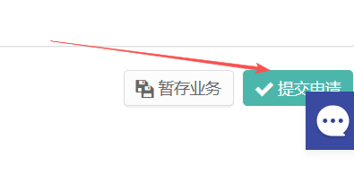

4.等国资处工作人员**审核通过**，即可打印出库单（单据补打----低耗品入账出库单），保存电子版，并打印一份纸质版

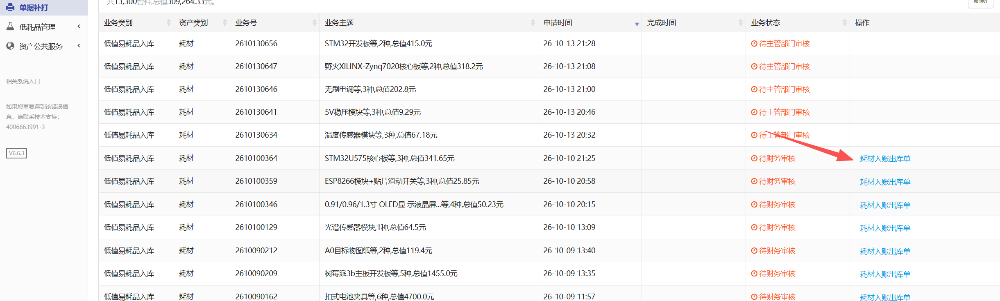

5.有了出库单，需要录入财务系统，智慧校园平台进入网上报账系统

> [!CAUTION]
>
> **必须先入库！**

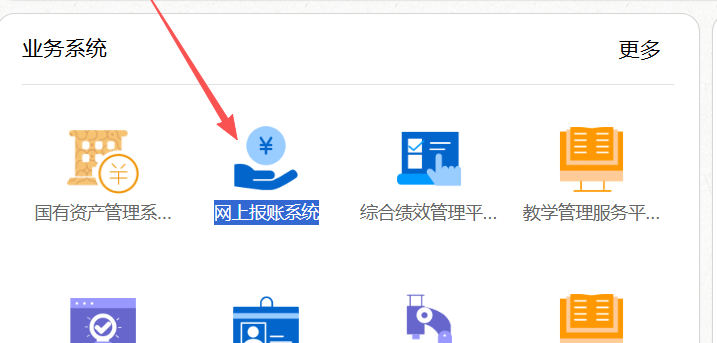

6.点击“一般报销”，进入报销流程，大创必须选择  公共项目—— 大学生创新训练项目培育经费-物理与光电工程学院

> [!CAUTION]
>
> 大创必须选择  公共项目—— 大学生创新训练项目培育经费-物理与光电工程学院！

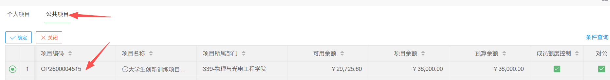

7.点击右侧“下一步”进入“票据查验”，

**在此之前，请将需要报销的、已经录入国资系统的耗材电子发票左上角二维码发给老师扫描，录入财务系统**

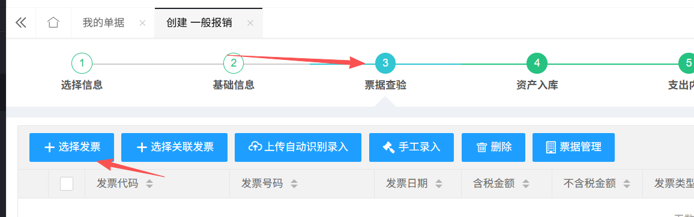

8.选择需要的发票，点击下一步进入资产入库

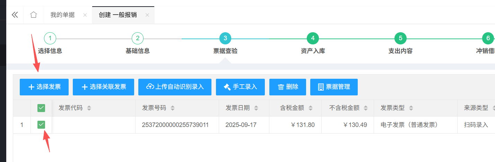

9.然后添加易耗品，选择与发票对应的易耗品(必须已经入库和录入）

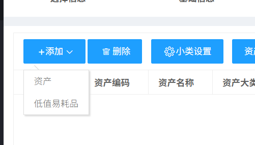

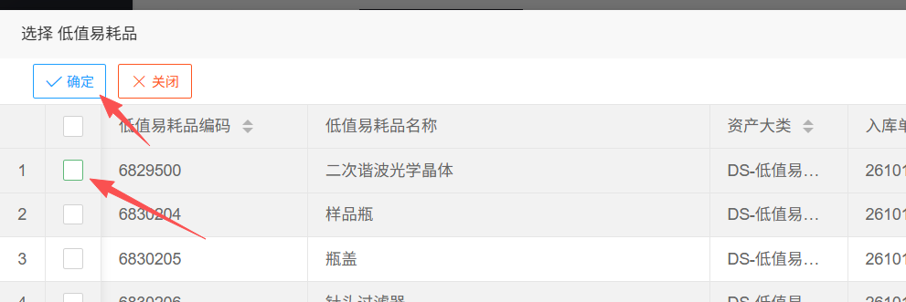

10.然后点击耗材条目的编辑，填写资产小类（大创耗材填写实验耗材）

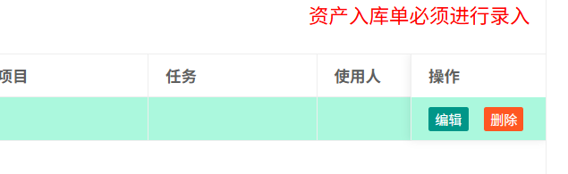

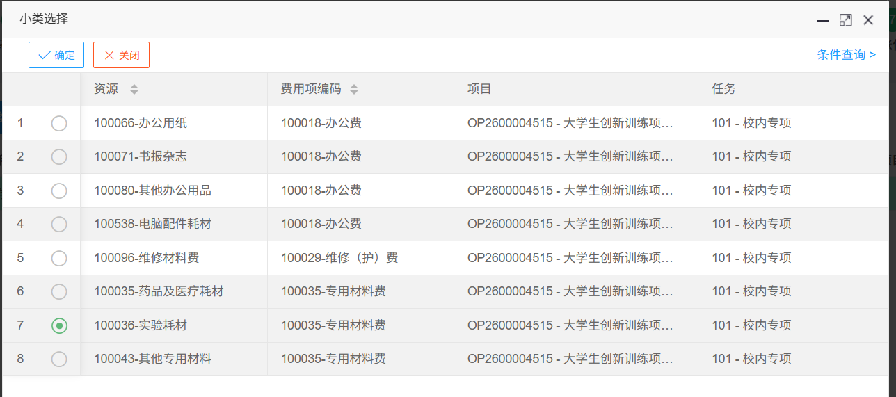

> [!IMPORTANT]
>
> （每一个耗材都得选择一次）

11.继续选择项目后，下一步

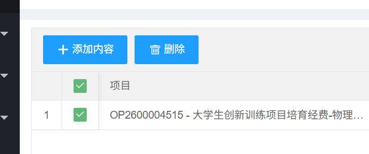

12.点击到“收款信息”，已经保存了老师的账户信息，这是收款账户，选择后下一步

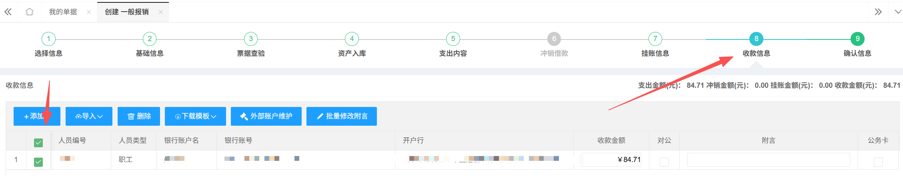

13.到最后，确认信息页面，需要**上传附件，包括发票、支付记录、情况说明、出库单**，有几个文件**附件数就填数字几**

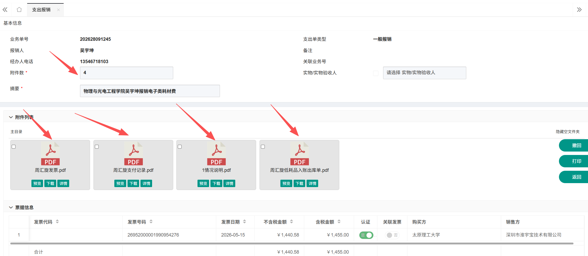

14.再次核对填写的信息，没有问题后提交让审核

15.审核后，需要再次打开财务系统，找到你提交的业务（支出报销），然后点击右侧打印按钮

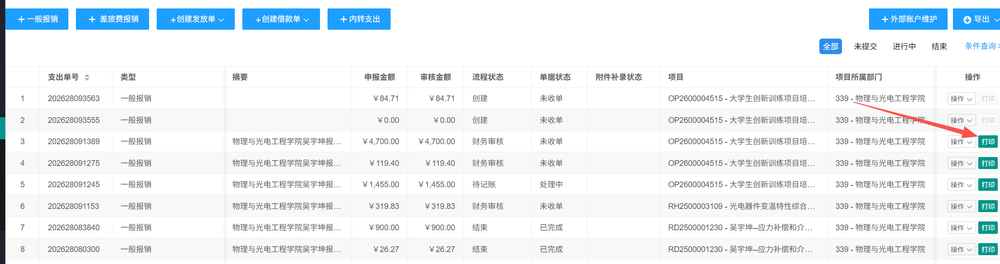

16.需要打印出来报销单，**接着找物电学院院长签字，院长签完字后盖章**

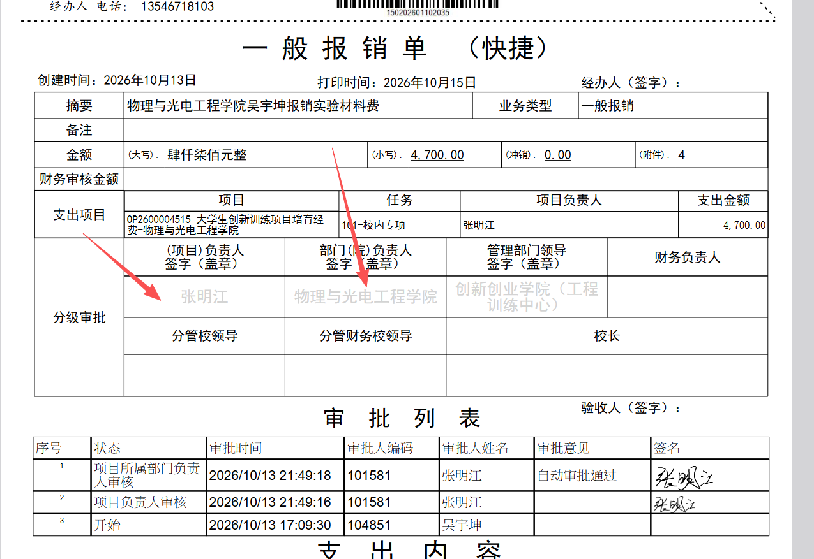

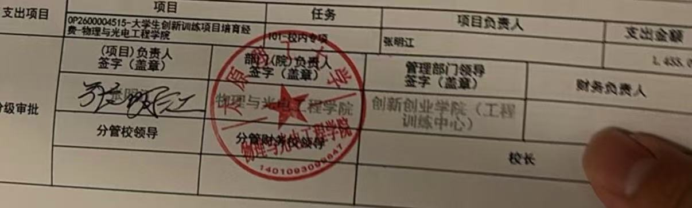

17.接着，将在财务系统提交的所有附件打印出来，粘贴到凭证粘贴单上面（右上角胶棒粘贴，注意正反），再将报销单和入库信息页粘到第1、2页

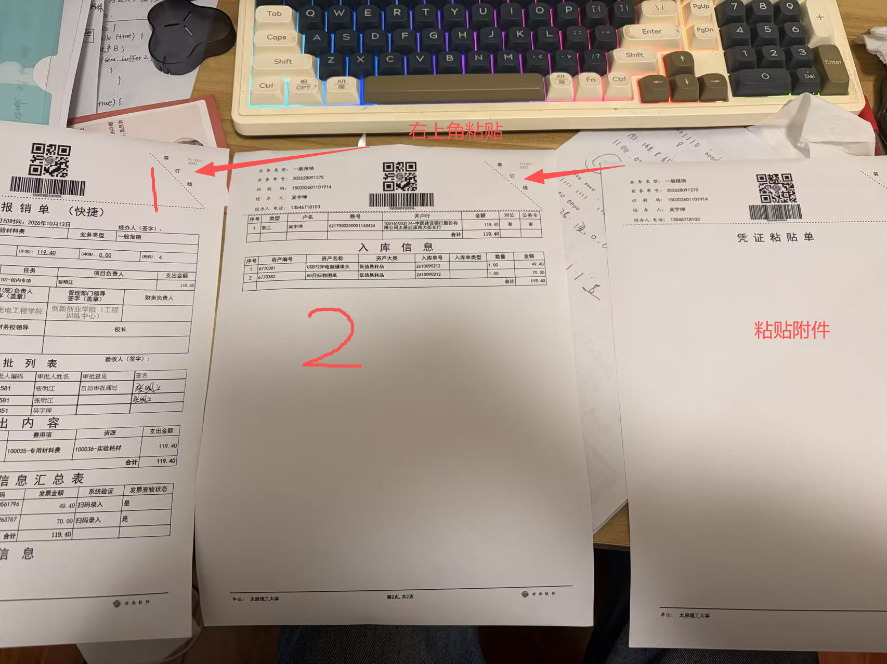

> [!WARNING]
>
> （特别提醒：国资系统出库单需要签字，其中经费负责人是大创项目的负责同学，验收人为老师，采购人为你自己）

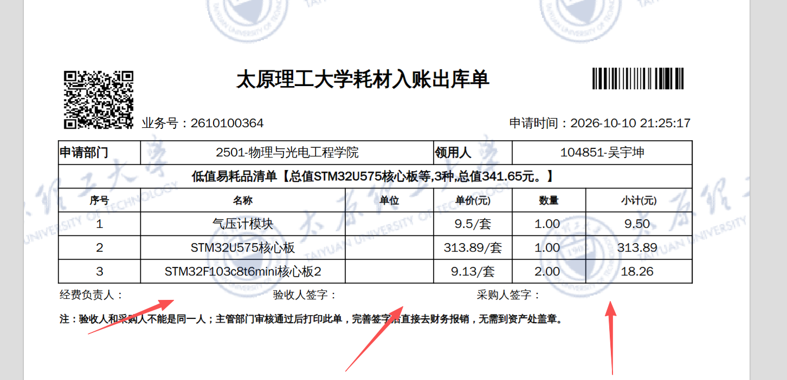

18.全部完成后，根据**报销单**业务单号尾号，将这一本材料交到**行政楼2楼财务大厅，（出电梯左转），如果尾号为5，就交5号台（看告示牌）**，后续有问题，需要拿回根据要求修改，没有问题则成功报销。